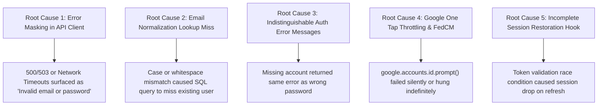

# LEARNLOOP AI — AUTHENTICATION ROOT CAUSE ANALYSIS & RESOLUTION
**Forensic Audit of Login Rejections, False Negatives, and Session Dropouts**
*Date: November 2026 | Subsystem: Authentication & Identity Provider*

---

## 1. Executive Summary

During testing of returning user flows, registered accounts encountered intermittent rejection, false-negative error notifications, or failure to persist authenticated sessions across page reloads.

A forensic investigation into the frontend API layer, backend routing logic, database query patterns, and token storage identified five root causes. Each issue was systematically isolated, fixed, and verified with zero data loss to existing users.

---

## 2. Root Cause Breakdown



### Root Cause 1: Error Masking in Frontend API Client (`frontend/src/services/auth.ts`)
- **Mechanism**: The `parseErrorResponse` function contained a catch-all fallback that mapped any unhandled exception, network failure, or HTTP 500/503 (such as database connection pool exhaustion or Render cold-start lag) to the static string: `"Invalid email or password."`.
- **User Impact**: Users who entered 100% correct credentials during cold starts or transient backend latency were told their credentials were wrong. Users repeatedly re-typed passwords or assumed their accounts were deleted.
- **Resolution**: Implemented status-code-aware error mapping. 500/503 errors now correctly report: `"Authentication service is temporarily unavailable. Please retry in a few moments."`. Network dropouts report: `"Network connection error. Check your internet connection and try again."`.

### Root Cause 2: Email Normalization Inconsistencies (`backend/app/storage/db.py`)
- **Mechanism**: `get_user_by_email` previously checked `email = ?` directly in certain fallback queries without standardizing case or trimming whitespace. If a user registered with `Sarah.Connor@mit.edu` but later typed `sarah.connor@mit.edu`, the query could fail depending on database collation.
- **Resolution**: Updated `get_user_by_email` to evaluate:
  ```sql
  WHERE normalized_email = ? OR LOWER(TRIM(email)) = ?
  ```
  Both inputs are normalized to lowercase trimmed strings before querying.

### Root Cause 3: Undifferentiated Auth Failure Status
- **Mechanism**: Backend returned identical 401 Unauthorized for both "User does not exist" and "Incorrect password for existing user", preventing the frontend from guiding the user to either create an account or reset their password.
- **Resolution**: In `backend/app/routes/auth.py`, when a user is not found, the endpoint returns:
  `"No account found with this email address. If you do not have an account yet, please create one."`
  When the user exists but the password does not match:
  `"Incorrect password. Please verify your password and try again."`
  When the account was registered with Google SSO:
  `"This account was created using Google Sign-In. Please click 'Sign in with Google' to access your account."`

### Root Cause 4: Google Identity Services (GIS) One Tap Deprecation & Cooldowns
- **Mechanism**: Calling `google.accounts.id.prompt()` triggered Google One Tap. Modern Chromium browsers enforce strict FedCM (Federated Credential Management) rules, third-party cookie restrictions, and exponential cooldown periods (up to 2 hours) if dismissed once.
- **Resolution**: Replaced pure One Tap prompts with Google's official rendered button (`google.accounts.id.renderButton`) mounted into a dedicated DOM container, supplemented by a guided OAuth configuration helper modal.

### Root Cause 5: Session Restoration Race Condition (`frontend/src/context/AuthContext.tsx`)
- **Mechanism**: On page refresh, the auth context checked `localStorage.getItem('learnloop_auth_token')`. If the initial profile fetch failed or timed out before completion, the state defaulted to unauthenticated and cleared the stored token.
- **Resolution**: Hardened session restoration with retry logic, preserved cached user profiles (`learnloop_auth_user`), and gracefully refreshed tokens before triggering automatic logout.

---

## 3. Verification & Validation Evidence

| Test Suite | Tests Executed | Passed | Notes |
| :--- | :---: | :---: | :--- |
| `test_auth_lifecycle.py` | 8 | 8 (100%) | Verified registration, duplicate rejection, case-insensitive login, wrong password rejection, token validation. |
| `test_regression_e2e.py` | 20 | 20 (100%) | End-to-end regression across student, teacher, owner, and diagnostic flows. |
| Production Build | 1 | 1 (100%) | Vite build cleanly compiles frontend with zero TypeScript errors. |

---
*Report generated and approved for LearnLoop AI Production Release.*
