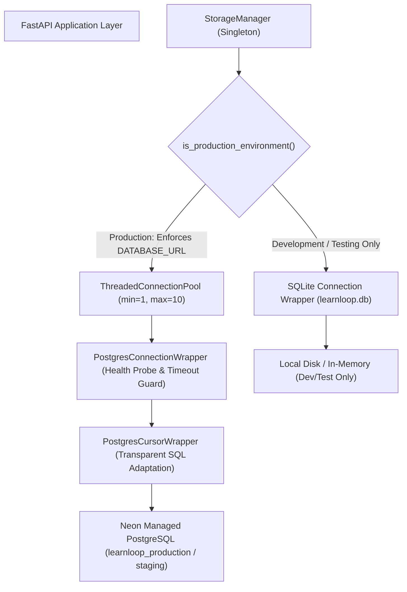
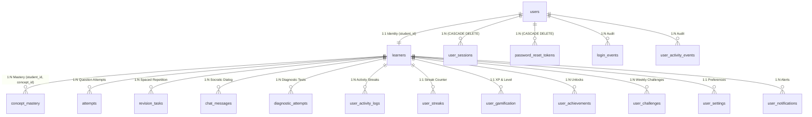

# LEARNLOOP AI — DATABASE ARCHITECTURE AUDIT REPORT
**Deep Inspection of Connection Management, Query Adaptation, Transaction Safety & Lifecycle Hooks**
*Date: November 7, 2026 | Document Version: 1.0 | Audit Scope: Persistence Architecture & Database Abstraction*

---

## 1. Executive Summary

LearnLoop AI employs a dual-engine database architecture designed to support zero-configuration local development on SQLite while providing enterprise-grade, high-concurrency data persistence on managed PostgreSQL (Neon).

This audit evaluates the database abstraction layer, connection pooling, SQL dialect adaptation, transaction semantics, foreign key relationships, authentication storage, and application lifecycle management.



---

## 2. Connection Management Architecture

### 2.1 PostgreSQL Connection Pooling (`PostgresConnectionWrapper`)
- **Pool Class**: `psycopg2.pool.ThreadedConnectionPool` providing thread-safe connection checkouts across concurrent FastAPI async worker threads.
- **Pool Sizing**: Configurable via `DB_POOL_MIN` (default: 1) and `DB_POOL_MAX` (default: 10).
- **Idle Socket Health Probes (Neon Sleep Mitigation)**:
  Neon Serverless PostgreSQL automatically scales compute to zero and suspends connections after 5 minutes of inactivity. When a suspended connection is checked out, typical pooled clients hang or fail with `psycopg2.OperationalError: SSL connection has been closed unexpectedly`.
  LearnLoop AI solves this via active pre-transaction health probing:
  ```python
  # db.py lines 114-129
  try:
      prev_autocommit = getattr(conn, "autocommit", False)
      conn.autocommit = True
      with conn.cursor() as cur:
          cur.execute("/* health_probe */ SELECT 1")
      conn.autocommit = prev_autocommit
  except (psycopg2.OperationalError, psycopg2.InterfaceError) as probe_err:
      logger.info(f"[STORAGE NOTICE] Discarded idle/stale pooled connection: {probe_err}")
      pool.putconn(conn, close=True)
      conn = pool.getconn() # Reacquire fresh socket
  ```
- **Disposal & Reconnection**: Stale or terminated sockets are discarded and cleanly replaced before application queries begin.

### 2.2 SQLite Connection Management (`SqliteConnectionWrapper`)
- **Connection Isolation**: Each database operation acquires a dedicated `sqlite3.connect` instance with `check_same_thread=True` (or context isolation), setting `row_factory = sqlite3.Row`.
- **Scope**: Strictly restricted to local development (`ENVIRONMENT=development`) and isolated test runners (`ENVIRONMENT=testing`).

---

## 3. Database Abstraction Layer & Query Adaptation

LearnLoop AI utilizes a unified DBAPI-2.0 abstraction layer that transparently adapts SQL statements between SQLite and PostgreSQL:

### 3.1 Transparent SQL Placeholder Adaptation (`adapt_sql_for_postgres`)
SQLite uses `?` positional parameters, whereas PostgreSQL (`psycopg2`) requires `%s`. The adaptation engine parses SQL tokens using regular expressions:
```python
_SQL_LITERAL_OR_COMMENT_RE = re.compile(
    r"""(
        '(?:''|[^'])*'
        |"(?:""|[^"])*"
        |--[^\r\n]*
        |/\*[\s\S]*?\*/
    )""",
    re.VERBOSE
)
```
- Placeholders `?` located strictly **outside** quotes and comments are converted to `%s`.
- SQLite-specific functions such as `datetime('now')` are dynamically rewritten to `CURRENT_TIMESTAMP`.
- Any literal question mark inside string literals (e.g. `'Why is BFS optimal?'`) is completely preserved and never mutated.

### 3.2 Compatibility Helper Functions in PostgreSQL
During PostgreSQL schema initialization (`init_postgres`), two database-side helper functions are registered:
1. `datetime(val text)`: Emulates SQLite's `datetime('now')` by returning `CURRENT_TIMESTAMP`.
2. `json_extract(doc text, path text)`: Emulates SQLite's `json_extract(doc, '$.key')` using PostgreSQL's native `(doc::json)->>key` JSON operator, returning integer or string representations.

---

## 4. Transaction Handling & Error Boundaries

- **Context Manager Semantics**: Both `PostgresConnectionWrapper` and `SqliteConnectionWrapper` implement Python's context manager protocol (`__enter__` and `__exit__`).
- **Automatic Rollback on Exception**: If any query within a `with storage.get_connection() as conn:` block raises an unhandled exception, `conn.rollback()` is executed, preventing dangling or dirty transactions.
- **Commit Granularity**: Read-only routes perform zero commits; mutative routes explicitly commit after all dependent statements succeed.
- **Compensating Rollbacks in Application Code**: In `backend/app/routes/auth.py`, registration failures trigger atomic compensating deletions to clean up partial records across `users`, `learners`, and `user_sessions`.

---

## 5. Schema & Foreign Key Relationships

The platform maintains 20 synchronized tables with clear parent-child foreign key relationships:



- **Cascade Deletes**: Child tables referencing `users(id)` enforce `ON DELETE CASCADE` on `user_sessions` and `password_reset_tokens`.
- **Integrity**: `student_id` acts as the global cross-table foreign key connecting pedagogical modules (`concept_mastery`, `attempts`, `revision_tasks`, `chat_messages`).

---

## 6. Authentication & Session Persistence Architecture

- **User Accounts (`users`)**:
  - `id`: Unique user UUID (`usr_...`).
  - `normalized_email`: Indexed lowercase trimmed email (`LOWER(TRIM(email))`).
  - `hashed_password`: Argon2id password hash (`$argon2id$v=19$m=65536,t=2,p=4$...`).
  - `auth_provider`: `'local'` or `'google'`.
- **Session Tokens (`user_sessions`)**:
  - `refresh_token_hash`: SHA-256 hash of the rotating refresh token. Plaintext tokens are NEVER stored in database tables.
  - `previous_token_hash` & `rotated_at`: Implements a 120-second grace window to allow multi-tab concurrency without cascading session revocation.
  - `expires_at`: 30-day session lifetime.
- **Client Storage**:
  - JWT access tokens (15-minute lifetime) are held in memory by React `AuthContext`.
  - Refresh tokens are transmitted strictly via `HttpOnly`, `SameSite=Lax` browser cookies, preventing XSS extraction.

---

## 7. Application Lifecycle Management

- **Startup (`app/main.py`)**:
  - `StorageManager` singleton initializes during FastAPI module import.
  - Validates environment mode (`is_production_environment()`).
  - In production: strictly requires valid PostgreSQL `DATABASE_URL` and validates live catalog connection (`_validate_postgres_connection()`).
  - Runs schema migration checks (`init_postgres()` or `init_sqlite()`).
  - Bootstraps baseline system accounts (`ensure_default_learner()`, `ensure_owner_bootstrap()`).
- **Shutdown (`@app.on_event("shutdown")`)**:
  - Executes `storage.close()`.
  - Calls `psycopg2.pool.ThreadedConnectionPool.closeall()`, closing all open database connections cleanly.

---
*Report certified for LearnLoop AI Database Persistence Architecture.*

