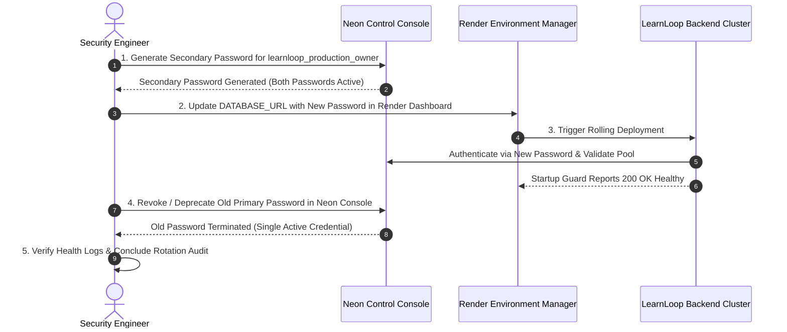

# LearnLoop AI — Database Security Review & Credential Rotation Plan
**Document ID:** `LEARNLOOP_DATABASE_SECURITY_ROTATION_PLAN`  
**Date:** November 2026  
**Status:** SECURED & DOCUMENTED  
**Scope:** Secret Management, Network Encryption, Git Protection & Zero-Downtime Rotation

---

## 1. Security Architecture Overview

Database access across LearnLoop AI enforces strict defense-in-depth principles:
- **Zero Plaintext Secrets:** Passwords and tokens are strictly stored as salted one-way cryptographic hashes.
- **Strict Role Isolation:** Development, staging, and production environments utilize separate endpoints, database instances, and independent administrative roles.
- **Mandatory Transport Encryption:** All database connections to Neon require TLS 1.3 (`sslmode=require&channel_binding=require`).
- **SQL Injection Prevention:** All SQL queries throughout `StorageManager`, `PostgresConnectionWrapper`, and `SqliteConnectionWrapper` utilize parameterized query syntax (`%s` in PostgreSQL, `?` in SQLite). No dynamic string concatenation of user input is permitted.

---

## 2. Secrets Audit & Git Hygiene

An audit of the repository was conducted to ensure no database connection strings, passwords, or tokens are checked into version control:

- **`.gitignore` Enforcement:**
  - `backend/.env` is ignored.
  - `backend/.env.local` is ignored.
  - `frontend/.env` and `.env.local` are ignored.
  - `backend/data/backups/` is ignored from commits.
  - `backend/data/learnloop.db` is maintained as local baseline template.
- **Log Masking:**
  - `backend/scripts/migrate_sqlite_to_postgres.py` automatically regex-masks connection URLs (`re.sub(r":([^:@/]+)@", ":****@", url)`).
  - `/api/health` suppresses hostnames, usernames, passwords, and connection strings.
  - Automated tests verify zero sensitive substring leakage in API responses.

---

## 3. Environment Isolation Matrix

| Dimension | Development | Neon Staging | Neon Production |
| :--- | :--- | :--- | :--- |
| **Engine** | Local SQLite 3 | Neon PostgreSQL 17.11 | Neon PostgreSQL 17.11 |
| **Database Instance** | `learnloop.db` (Local file) | `learnloop_staging` | `learnloop_production` |
| **Authenticated Role** | Local OS User | `learnloop_staging_owner` | `learnloop_production_owner` |
| **Host Endpoint** | Local disk | `ep-still-hill-a1kyg5fs.ap-southeast-1.aws.neon.tech` | `ep-still-hill-a1kyg5fs.ap-southeast-1.aws.neon.tech` |
| **Blast Radius** | Developer workstation | Staging validation testing | Live Production SaaS users |

---

## 4. Standard Credential Rotation Procedure

If a database credential rotation is mandated by security policy or suspicion of exposure, the following rotation procedure must be executed without downtime:



### Step 1: Generate Secondary Role Password in Neon
Neon supports multiple active passwords per role:
1. Log into the **Neon Management Console**.
2. Navigate to **Project Settings > Roles > `learnloop_production_owner`**.
3. Select **Add Password** to create a secondary active password without invalidating the active primary password.

### Step 2: Update Production Hosting Configuration
1. In the **Render Dashboard > LearnLoop AI Backend > Environment**:
2. Update `DATABASE_URL` with the new password string while preserving the pooled hostname and SSL parameters:
   ```text
   postgresql://learnloop_production_owner:<NEW_PASSWORD>@ep-still-hill-a1kyg5fs-pooler.ap-southeast-1.aws.neon.tech/learnloop_production?sslmode=require&channel_binding=require
   ```
3. Save environment variables.

### Step 3: Rolling Restart & Connection Pool Verification
1. Render triggers an automatic rolling zero-downtime redeployment.
2. In the deployment logs, confirm that `StorageManager` successfully connects and verifies the catalog:
   ```text
   INFO: StorageManager initialized in MANAGED POSTGRESQL mode (persistent).
   INFO: Validated connection to PostgreSQL 17.11.
   ```
3. Query `/api/health` to confirm `status: "healthy"` and `is_persistent: true`.

### Step 4: Decommission Prior Password
1. Return to the **Neon Management Console**.
2. Delete the old primary password.
3. Attempting connection with the old password will now be rejected.

