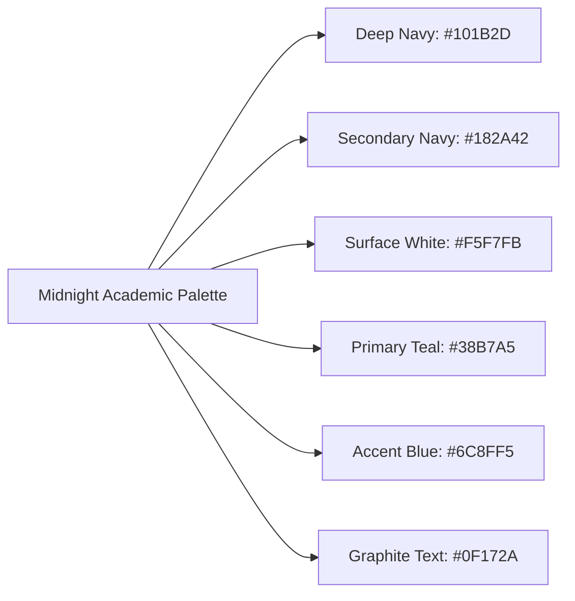
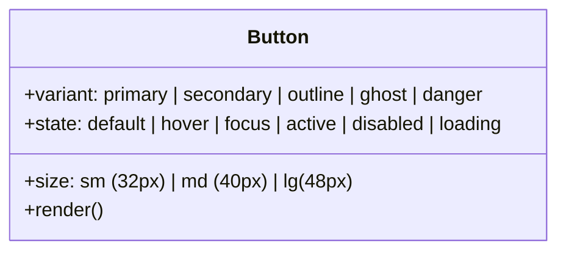

# LearnLoop AI — Design System Specification
## Midnight Academic Design System & UI Component Standard

**Document Version:** 1.0  
**Brand Direction:** Midnight Academic  
**Target Viewports:** Mobile (375px+), Tablet (768px+), Desktop (1024px+), Wide (1440px+)  
**Typography Suite:** Inter (Body/UI), Plus Jakarta Sans (Display Headings), JetBrains Mono (Code/Telemetry)  
**Accessibility Level:** WCAG 2.2 AA Compliant  
**Status:** **APPROVED SPECIFICATION — READY FOR COMPONENT LIBRARY INTEGRATION**

---

## 1. Brand Philosophy & Design Principles

LearnLoop AI embodies **Midnight Academic**—an aesthetic that reflects intellectual rigor, architectural precision, and focused study. It combines the deep, calming atmosphere of a late-night academic library with the crisp, modern clarity of a high-performance developer workspace.

### Core Principles:
1. **Academic Clarity Over Decoration:** Eliminate excessive gradients, gratuitous glassmorphism, floating decorative orbs, and oversized blurry drop shadows. Every visual element must serve information comprehension.
2. **Predictable 8px Spatial Rhythm:** All margins, paddings, gap dimensions, and component heights adhere strictly to an 8px grid (with 4px half-step micro-units).
3. **High-Contrast Legibility:** All text pairings exceed the WCAG 2.2 AA contrast requirement ($\ge 4.5:1$ for body text, $\ge 3:1$ for large headings and UI icons).
4. **Resilient Dark & Light Modes:** Built on CSS custom properties (`var(--...)`) with semantic token mapping rather than hardcoded Tailwind hex codes.

---

## 2. Color System & Semantic Tokens

### 2.1 Foundational Palette


| Token Name | Hex Code | Light Theme Usage | Dark Theme Usage | Contrast Ratio vs Background |
|---|---|---|---|:---:|
| **Deep Navy** | `#101B2D` | Dark theme surface/bg, light theme brand emphasis | Dark theme root background | 16.2:1 (on white) |
| **Secondary Navy** | `#182A42` | Navigation accents, dark badges | Dark theme card surfaces | 13.8:1 (on white) |
| **Surface White** | `#F5F7FB` | Primary light theme application canvas | N/A (light canvas only) | Base |
| **Primary Teal** | `#38B7A5` | Interactive primaries, mastery milestones, success | Active links, primary actions, highlights | 4.62:1 (on dark) |
| **Accent Blue** | `#6C8FF5` | Focus rings, secondary highlights, AI agent markers | Secondary accents, progress indicators | 5.14:1 (on dark) |
| **Graphite Text** | `#0F172A` | Primary heading and body copy in light mode | N/A (light mode text) | 16.8:1 (on white) |
| **Muted Slate** | `#475569` | Secondary captions, timestamps, helper descriptions | Secondary text in dark mode (`#94A3B8`) | 5.92:1 (on white) |
| **Subtle Border** | `#E2E8F0` | Structural card borders and table dividers | Dark border (`#1E293B`) | Clean separation |

### 2.2 Semantic CSS Variables (Theme Architecture)

```css
:root {
  /* Canvas & Surfaces */
  --bg-app: #F5F7FB;
  --bg-surface: #FFFFFF;
  --bg-surface-hover: #F1F4F9;
  --bg-subtle: #EEF2F6;
  --bg-header: rgba(255, 255, 255, 0.95);
  
  /* Text & Typography */
  --text-primary: #0F172A;
  --text-secondary: #475569;
  --text-muted: #64748B;
  --text-inverse: #FFFFFF;
  
  /* Interactive Brand */
  --brand-primary: #38B7A5;
  --brand-primary-hover: #2DA292;
  --brand-primary-light: #E8F8F5;
  --brand-accent: #6C8FF5;
  --brand-accent-hover: #587CE4;
  --brand-accent-light: #EEF3FE;
  
  /* Borders & Dividers */
  --border-subtle: #E2E8F0;
  --border-focus: #38B7A5;
  --border-active: #6C8FF5;
  
  /* Feedback States */
  --feedback-success: #10B981;
  --feedback-warning: #F59E0B;
  --feedback-danger: #EF4444;
  --feedback-info: #3B82F6;
  
  /* Shadows & Elevation */
  --shadow-xs: 0 1px 2px 0 rgba(16, 27, 45, 0.05);
  --shadow-card: 0 1px 3px 0 rgba(16, 27, 45, 0.06), 0 1px 2px 0 rgba(16, 27, 45, 0.04);
  --shadow-elevated: 0 4px 6px -1px rgba(16, 27, 45, 0.08), 0 2px 4px -2px rgba(16, 27, 45, 0.04);
  --shadow-modal: 0 20px 25px -5px rgba(16, 27, 45, 0.12), 0 8px 10px -6px rgba(16, 27, 45, 0.06);
}

.dark {
  /* Canvas & Surfaces */
  --bg-app: #101B2D;
  --bg-surface: #182A42;
  --bg-surface-hover: #203554;
  --bg-subtle: #142236;
  --bg-header: rgba(16, 27, 45, 0.95);
  
  /* Text & Typography */
  --text-primary: #F8FAFC;
  --text-secondary: #94A3B8;
  --text-muted: #64748B;
  --text-inverse: #0F172A;
  
  /* Borders & Dividers */
  --border-subtle: #243854;
  --border-focus: #38B7A5;
  --border-active: #6C8FF5;
  
  /* Feedback States */
  --brand-primary-light: rgba(56, 183, 165, 0.15);
  --brand-accent-light: rgba(108, 143, 245, 0.15);
}
```

---

## 3. Typography Hierarchy

### 3.1 Font Family Stacks
- **Display & Headings:** `'Plus Jakarta Sans', -apple-system, BlinkMacSystemFont, 'Segoe UI', Roboto, sans-serif`
- **Interface & Body:** `'Inter', -apple-system, BlinkMacSystemFont, 'Segoe UI', Roboto, sans-serif`
- **Code & Telemetry:** `'JetBrains Mono', 'Fira Code', Menlo, Monaco, monospace`

### 3.2 Type Scale
| Style Level | Font Family | Size (px / rem) | Line Height | Weight | Tracking | Primary Usage |
|---|---|---|---|---|---|---|
| **Display 2XL** | Plus Jakarta Sans | 40px / 2.5rem | 1.2 | Bold (700) | -0.02em | Hero headline on Landing Page |
| **Display XL** | Plus Jakarta Sans | 32px / 2.0rem | 1.25 | Bold (700) | -0.015em | Top-level page titles (Dashboard, Tutor) |
| **Heading LG** | Plus Jakarta Sans | 24px / 1.5rem | 1.3 | SemiBold (600) | -0.01em | Card group headers, section titles |
| **Heading MD** | Plus Jakarta Sans | 20px / 1.25rem | 1.35 | SemiBold (600) | -0.005em | Modal titles, quiz questions |
| **Subheading** | Inter | 16px / 1.0rem | 1.4 | Medium (500) | Normal | Question options, card headers |
| **Body Regular** | Inter | 14px / 0.875rem | 1.5 | Regular (400) | Normal | Standard reading text, explanations |
| **Body Small** | Inter | 12px / 0.75rem | 1.45 | Medium (500) | Normal | Table cells, helper descriptions |
| **Caption / Label** | Inter | 11px / 0.6875rem | 1.4 | SemiBold (600) | +0.02em | Badges, tags, form field labels |
| **Code Block** | JetBrains Mono | 13px / 0.8125rem | 1.6 | Regular (400) | Normal | Code snippets, algorithm complexity |
| **Telemetry Pill** | JetBrains Mono | 11px / 0.6875rem | 1.3 | Medium (500) | +0.01em | Engine status, metrics, timers |

---

## 4. Spacing, Layout Grid & Elevation

### 4.1 8px Grid Scale
```text
  0.5 (4px)  | Micro gaps, icon padding, badge padding
  1.0 (8px)  | Compact element spacing, tight button padding
  1.5 (12px) | Standard input padding, badge horizontal padding
  2.0 (16px) | Standard card padding (mobile), button height padding
  3.0 (24px) | Desktop card padding, section gap
  4.0 (32px) | Major component separation
  6.0 (48px) | Page section margins
  8.0 (64px) | Large landing section spacing
```

### 4.2 Border Radius System
- **`rounded-sm` (4px):** Code badges, micro-tooltips.
- **`rounded-md` (8px):** Form inputs, secondary buttons, select dropdowns.
- **`rounded-lg` (12px):** Standard interactive cards, primary buttons, notification items.
- **`rounded-xl` (16px):** Main feature cards, modal dialog containers, dashboard widgets.
- **`rounded-2xl` (20px):** Large hero panels, callout banners.
- **`rounded-full` (9999px):** Status pills, avatar circles, filter chips.

---

## 5. UI Component Specifications

### 5.1 Buttons
All buttons enforce a minimum touch target of $44 \times 44\text{px}$ on mobile viewports and visible focus styling.



1. **Primary Button:**
   - Background: `var(--brand-primary)` (`#38B7A5`)
   - Hover: `#2DA292` | Text: `#FFFFFF` (Bold 600)
   - Focus: `ring-2 ring-[#38B7A5] ring-offset-2 ring-offset-white`
   - Usage: "Start Quiz", "Submit Answer", "Get Started Free".
2. **Secondary Button:**
   - Background: `var(--bg-subtle)` (`#EEF2F6`)
   - Hover: `#E2E8F0` | Text: `var(--text-primary)` (`#0F172A`)
   - Usage: "Skip", "View Details", "Back".
3. **Outline Button:**
   - Background: Transparent | Border: `1px solid var(--border-subtle)` (`#E2E8F0`)
   - Hover: `bg-white shadow-xs border-[#CBD5E1]`
   - Usage: "Filter", "Download CSV", "Refresh".
4. **Danger Button:**
   - Background: `#EF4444` | Hover: `#DC2626` | Text: `#FFFFFF`
   - Usage: "Reset Profile", "Delete Session".

### 5.2 Form Inputs & Controls
- **Base Height:** 44px (touch-friendly on all viewports).
- **Default State:** `bg-white border border-[#CBD5E1] rounded-lg text-sm text-[#0F172A] px-3.5 py-2.5`.
- **Focus State:** `border-[#38B7A5] ring-2 ring-[#38B7A5]/25 outline-none`.
- **Error State:** `border-[#EF4444] ring-2 ring-[#EF4444]/20`. Inline error message displayed beneath input with `role="alert"`.
- **Labels:** Always accompanied by explicit `<label>` tags with `htmlFor` association.

### 5.3 Cards & Surface Panels
- Background: `var(--bg-surface)` with `border border-[var(--border-subtle)]`.
- Shadow: `var(--shadow-card)` on rest; `translate-y-[-1px] shadow-elevated` on interactive hover.
- Eliminates heavy borders, fluorescent gradients, and glassy blur effects.

### 5.4 Dialogs & Modals
- Backdrop: `rgba(16, 27, 45, 0.60)` with subtle `backdrop-blur-xs` (not heavy blur).
- Container: Centered flexbox with `max-h-[90vh] overflow-y-auto rounded-xl shadow-modal`.
- Accessibility: Focus trapped programmatically, `role="dialog"`, `aria-modal="true"`, closed on Escape key or backdrop click.

---

## 6. Layout & Navigation Hierarchy

### 6.1 Desktop Layout ($\ge 1024\text{px}$)
- **Left Sidebar Navigation (240px fixed width):** Clean vertical navigation grouping features into role-specific workspaces (Overview, Learning, Assessments, Practice, Analytics).
- **Top Utility Header (56px height):** Logo badge, global command search (`Cmd+K`), active learner mastery pill, notifications bell, and user account menu.
- **Main Canvas:** Centered, responsive width up to `max-w-7xl` (1280px).

### 6.2 Mobile Layout ($< 768\text{px}$)
- **Top Mobile Header (52px height):** Brand logo + account avatar + hamburger trigger.
- **Bottom Navigation Bar (56px height, fixed):** Top 4 high-frequency destinations (Dashboard, Tutor, Quiz, Revision) with $44\text{px}$ touch targets.
- **Slide-Over Drawer:** Full navigation, settings, live video solver, and help/support.
