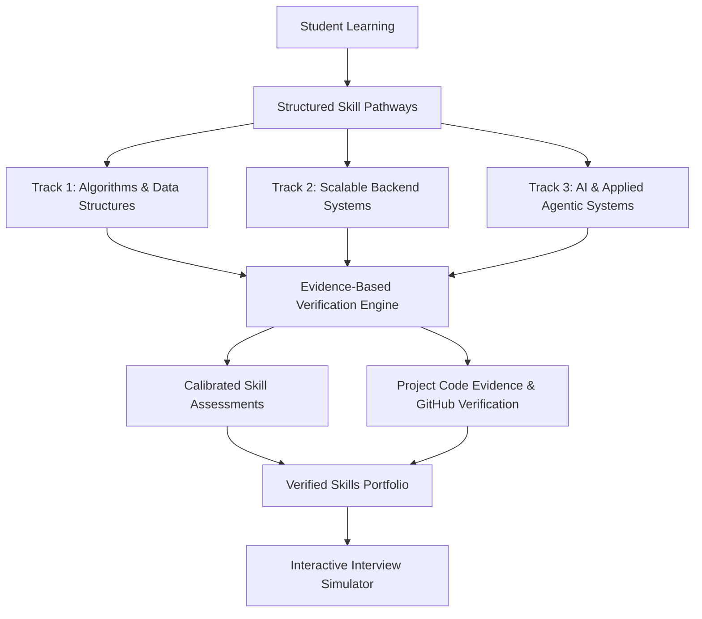
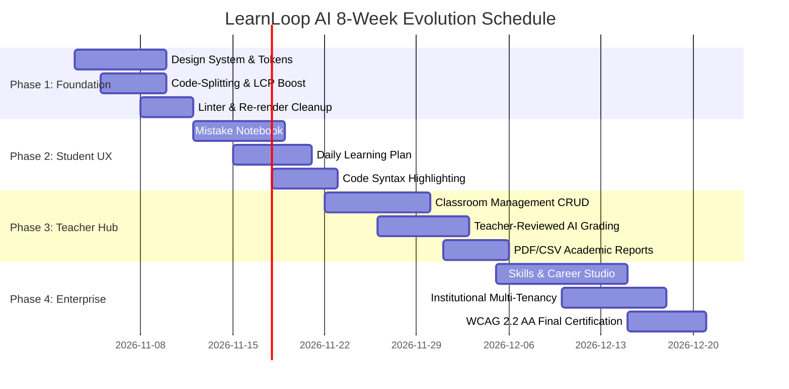

# LearnLoop AI — Feature Roadmap & Strategic Vision
## Skills & Career Studio, Pedagogical Enhancements & Implementation Schedule

**Document Version:** 1.0  
**Planning Horizon:** 8 Weeks (4 Sprints)  
**Standard of Credibility:** Evidence-Based Skill Verification, Zero Inflated Badges  
**Status:** **APPROVED STRATEGIC ROADMAP**

---

## 1. Executive Summary

This roadmap establishes the feature trajectory for LearnLoop AI, expanding its core DSA exam-preparation capabilities into a comprehensive academic and professional-growth platform.

The roadmap is guided by two strict tenets:
1. **Academic Credibility Over Vanity Gamification:** Every credential or mastery badge must be backed by verifiable assessment data or concrete project code artifacts. We reject hollow points, superficial badges, and fake "certificates of completion".
2. **Pedagogical Alignment:** Features are designed to reduce cognitive load, detect misconceptions early, and promote long-term memory retention through modified SM-2 spaced repetition.

---

## 2. Deep Dive: Skills & Career Studio (Phase F)

The **Skills & Career Studio** bridges the gap between academic theory (DSA, algorithms, complexity) and real-world software engineering practice.

### 2.1 Structured Skill Pathways
Four focused tracks tailored to real industry engineering roles:
1. **Algorithms & Complex Problem Solving:** Core DSA, dynamic programming, graph algorithms, asymptotic analysis, competition prep.
2. **Scalable Backend Architecture:** API design (FastAPI/REST), relational databases (PostgreSQL), connection pooling, caching strategies (Redis), data integrity.
3. **AI & Agentic Systems:** LLM tool-calling, prompt engineering, agentic loops, evaluation benchmarks, semantic retrieval.
4. **Startup & Engineering Leadership:** Technical scoping, system tradeoffs, code review standards, sprint estimation.

### 2.2 Proof-of-Skill Architecture & Credential Integrity
> [!IMPORTANT]
> **No Fake Certificates:** LearnLoop AI strictly differentiates self-reported skills from demonstrated skills. No automated "diplomas", blockchain tokens, or unverifiable endorsements will be issued.

| Skill Display Tier | Criteria Required | Visual Badge Style | Export Format |
|---|---|---|---|
| **Self-Reported Interest** | Selected during onboarding or profile editing | Muted gray tag (`Interests: System Design`) | Profile only |
| **Assessment Verified** | $>80\%$ score on timed, proctored adaptive assessment | Blue shield badge (`Verified DSA: Stacks & Trees`) | Signed JSON metadata |
| **Artifact Verified** | Working GitHub project repository submitted & tested | Emerald star badge (`Demonstrated Project: KV Cache`) | Public portfolio link with commit hash |

### 2.3 Interactive Technical & Behavioral Interview Prep
- **Socratic Code Interviewer:** The AI Tutor acts as a senior engineering interviewer, presenting an algorithmic challenge, observing real-time coding, and offering calibrated hints without revealing the solution.
- **Behavioral STAR Simulator:** Practice answering behavioral questions (Conflict resolution, technical leadership, project deadlines) with structured feedback on Situation, Task, Action, and Result.

---

## 3. Four-Phase Chronological Implementation Roadmap

### Phase 1 (Weeks 1–2): UI Polish, Design System & Performance
- Implement Midnight Academic design tokens (CSS variables for light/dark modes).
- Route-level code splitting via `React.lazy` to cut bundle size from 1,012 kB to $<200\text{ kB}$ gzip.
- Fix all 115 oxlint warnings (`set-state-in-effect`, impure render blocks).
- Implement uniform visible focus rings and WCAG 2.2 AA color contrast adjustments.

### Phase 2 (Weeks 3–4): Enhanced Student Experience
- Build **Mistake Notebook & Misconception Review** view with targeted retries.
- Deploy **Daily Action Plan** queue on dashboard with estimated time commitment.
- Add code syntax highlighting (Prism.js) for code options and tutor dialogues.
- Deep-linkable URL routing for assessments, quizzes, and tutor sessions.

### Phase 3 (Weeks 5–6): Educator Hub & Classroom Management
- Backend data model & endpoints for `classrooms`, `enrollments`, and `assignments`.
- Educator interface for classroom roster management and 6-character join codes.
- Implement **Teacher-Reviewed AI Grading** workflow with explicit approval gates.
- One-click CSV and printable PDF progress report generation.

### Phase 4 (Weeks 7–8): Skills Studio & Institutional Expansion
- Roll out Skills & Career Studio tracks and verified portfolio badges.
- Institutional Administrator console with department and course telemetry.
- Comprehensive end-to-end regression testing and final accessibility certification.

---

## 4. Explicit Scope Discipline: Features That Should NOT Be Built Yet

To preserve engineering focus, performance, and international credibility, the following features are **explicitly rejected from the near-term roadmap**:

1. **Web3 / Blockchain Credentials / NFT Diplomas:** Adds zero pedagogical value, introduces regulatory risks, and damages academic credibility with institutional partners.
2. **Real-Time Multiplayer Coding PvP Games:** Encourages reckless speed-typing rather than deep conceptual understanding, algorithm analysis, and invariant verification.
3. **Unmoderated Social Feeds & Public Comments:** Generates significant moderation overhead, spam exposure, and distracts learners from focused study.
4. **Fully Autonomous Unverified AI Grading:** Violates core educational compliance and accreditation standards (FERPA/GDPR); AI must remain an assistant to human educators.
5. **Premature Microservices Architecture:** The existing FastAPI modular monolith is fast, maintainable, and low-latency. Splitting into multiple network services would increase cold-start latency and operational complexity without justification.
