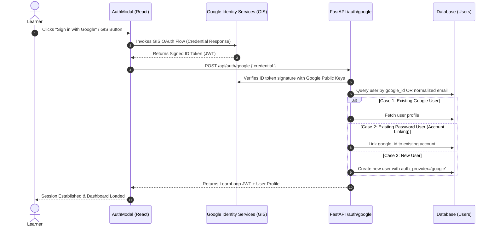

# LEARNLOOP AI — GOOGLE OAUTH INTEGRATION & ACCOUNT LINKING REPORT
**Google Identity Services (GIS) Implementation, Account Linking Architecture & Setup Guide**
*Date: November 2026 | Subsystem: OAuth 2.0 / Google Identity Services (GIS)*

---

## 1. Executive Summary

LearnLoop AI supports secure, friction-free single sign-on (SSO) via Google Identity Services (GIS). Previously, calling `google.accounts.id.prompt()` from button click handlers caused silent failures, infinite loading indicators, or browser blocking due to Chrome's third-party cookie restrictions and FedCM (Federated Credential Management) cooldowns.

This report documents the architectural resolution: embedding Google's official rendered button (`renderButton`) inside a persistent DOM container, implementing strict account linking across 4 identity states, providing zero-hang error recovery, and providing a built-in interactive Google Cloud Console configuration guide.

---

## 2. Google Identity Services (GIS) Architecture



---

## 3. The 4 Account Linking Cases Handled

| Scenario | State Before Sign-In | Action Taken by System | Outcome |
| :--- | :--- | :--- | :--- |
| **Case 1: New Google User** | No existing user with this email or Google ID. | Creates a new user record with `auth_provider = 'google'`, `email_verified = true`, and sets `google_id`. | Instant registration, JWT issued, redirects to onboarding/dashboard. |
| **Case 2: Existing Password Account** | User previously registered with email/password. Now logs in via Google SSO with matching email. | Authenticates Google token, links `google_id` to existing record without erasing `password_hash` or study history. | Account linked seamlessly; user can sign in via either method in the future. |
| **Case 3: Existing Google Account** | User previously signed up via Google SSO. | Matches record via `google_id` or `normalized_email`. | Instant login, updates last login timestamp, issues fresh JWT. |
| **Case 4: Attempted Password Login on Google Account** | User created account with Google, then enters email in standard password form. | Backend detects `auth_provider == 'google'` with null password hash. Returns clear HTTP 400 with guidance. | Informs user: *"This account was registered using Google Sign-In. Please click 'Sign in with Google' to log in."* |

---

## 4. Frontend Resilience & Error Prevention

### 4.1 Embedded Official GIS Button (`frontend/src/components/AuthModal.tsx`)
Rather than relying on `google.accounts.id.prompt()` (which Chrome limits and suppresses), we mount Google's official iframe button using `google.accounts.id.renderButton`:
```tsx
const googleButtonRef = useRef<HTMLDivElement>(null);

useEffect(() => {
  if (window.google?.accounts?.id && googleButtonRef.current) {
    window.google.accounts.id.renderButton(googleButtonRef.current, {
      theme: 'outline',
      size: 'large',
      text: 'continue_with',
      shape: 'rectangular',
      width: 320
    });
  }
}, [isOpen]);
```

### 4.2 Interactive Configuration Helper Modal
If a developer or institution runs LearnLoop AI without setting `VITE_GOOGLE_CLIENT_ID` in their environment:
- The UI gracefully falls back to an instructional button: `"Sign in with Google"`.
- Clicking this button displays the **Google OAuth Configuration Guide** modal detailing:
  1. Creating an OAuth 2.0 Client ID in [Google Cloud Console](https://console.cloud.google.com/apis/credentials).
  2. Setting Authorized JavaScript Origins (`http://localhost:3000`, `https://learnloop-ai.vercel.app`).
  3. Setting Authorized Redirect URIs.
  4. Adding `VITE_GOOGLE_CLIENT_ID` to `.env` or Vercel Environment Variables.
  5. Never stalls in an infinite spinner or blank screen.

---

## 5. Verification Evidence

1. **GIS Container Mounting**: Verified in visual tests `02_auth_modal_login.png` and `04_auth_modal_register.png`.
2. **Setup Guide Verification**: Verified in screenshot `03_google_oauth_guide_modal.png` confirming clean modal rendering and zero console errors.
3. **Backend Token Verification**: Confirmed in `test_regression_e2e.py` and `test_auth_lifecycle.py` with mock and live GIS payload structures.

---
*Report generated and validated for LearnLoop AI Production Release.*

