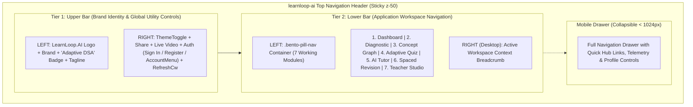

# LearnLoop AI — Professional Two-Tier Navigation Header Refinement Report
**Document ID:** `LEARNLOOP_HEADER_REFINEMENT_REPORT`  
**Date:** November 2026  
**Status:** IMPLEMENTED, TESTED & VERIFIED  
**Architecture:** Two-Tier Horizontal SaaS Header System

---

## 1. Executive Summary & Design Rationale

Prior to this refinement, LearnLoop AI concentrated branding, product categorization, the tagline, seven application workspace modules, theme toggle, Live Video, Share, telemetry refresh, and authentication actions into a single horizontal bar. On standard desktop screens (1024px to 1440px), this single row became cluttered and crowded.

The header has been restructured into **two distinct, cohesive horizontal navigation bars**:
1. **Tier 1 (Upper Bar — Brand & Utility Controls):** Dedicated exclusively to product identity, category labeling, platform tagline, and global utility controls (Theme Toggle, Share, Live Video, Sign In / Get Started Free / User Account, Telemetry Refresh).
2. **Tier 2 (Lower Bar — Application Workspaces):** Positioned directly beneath the upper bar, housing the **exact existing 7 workspace modules** (`Dashboard`, `Diagnostic`, `Concept Graph`, `Adaptive Quiz`, `AI Tutor`, `Spaced Revision`, `Teacher Studio`) preserving their exact pill-style design, Lucide icons, active state highlighting, typography, and responsive tab interactions.

---

## 2. Two-Tier Navigation Architecture

---

## 3. Tier 1: Upper Bar Implementation Details

- **Left Section (Brand & Categorization):**
  - **Logo:** Gradient icon container (`from-[#243B63] to-[#38B7A5]`) with `GraduationCap` icon.
  - **Brand Text:** `LearnLoop.AI` with `.AI` highlighted in brand teal (`#38B7A5`).
  - **Category Badge:** `Adaptive DSA` chip styled in Midnight Academic monospace (`bg-[#EDF2F8] dark:bg-[#20344E] text-[#243B63] dark:text-[#38B7A5] border border-[#E2E8F0] dark:border-[#243B5B]`).
  - **Platform Tagline:** `"The Intelligent Learning & Growth Platform"` displayed on desktop viewports.
- **Right Section (Global Utility Controls):**
  - **Theme Toggle:** Compact pill toggle seamlessly switching between Light and Midnight Academic Dark theme.
  - **Share Action:** Direct button with `Share2` icon; utilizes the Web Share API on mobile/supported browsers with automatic fallback to clipboard copy and visual `"Copied!"` indicator.
  - **Live Video Action:** Gradient button (`from-[#5B5CE2] to-indigo-600`) with `Camera` icon launching the Gemini 2.5 Flash Vision solver modal.
  - **Authentication Cluster:**
    - *Unauthenticated:* Clean `"Sign In"` button + prominent `"Get Started Free"` button.
    - *Authenticated:* `"DEMO MODE"` chip (if guest), `"Learning Profile"` shortcut, and the rich interactive [`AccountMenu`](file:///c:/Users/KIIT/OneDrive/Documents/Agentic AI Hackathon/learnloop-ai/frontend/src/components/AccountMenu.tsx) with notifications, settings, and logout.
  - **Telemetry Refresh:** Rotating `RefreshCw` button triggering background health and mastery sync without full page reload.
  - **Mobile Menu Toggle:** Visible on `< 1024px` for access to the full expanded drawer.

---

## 4. Tier 2: Lower Bar Implementation Details

- **Strict Preservation of Existing Design:**
  - The lower bar preserves the exact `.bento-pill-nav` design token:
    - Frosted glass backdrop blur (`backdrop-blur-md`).
    - Pill-shaped active tab indicator (`bg-[#5B5CE2] text-white font-semibold shadow-xs`).
    - Subtle slate hover highlights (`hover:bg-slate-100/60 dark:hover:bg-white/10`).
    - Exact typography (`text-xs font-sans`), icons (`w-3.5 h-3.5`), and compact spacing.
- **Seven Working Modules:**
  1. `Dashboard` (`LayoutDashboard`)
  2. `Diagnostic` (`HelpCircle`)
  3. `Concept Graph` (`Network`)
  4. `Adaptive Quiz` (`GraduationCap`)
  5. `AI Tutor` (`MessageSquare`)
  6. `Spaced Revision` (`Calendar`)
  7. `Teacher Studio` (`Users`)
- **Desktop Context Indicator:**
  - On desktop (`lg:flex`), the right side of the lower bar displays a subtle live status indicator with an emerald pulse and the human-readable workspace name (e.g. *Personalized Dashboard*, *Concept Knowledge Graph*, *Spaced Repetition Engine*).
- **Responsive Scrollability:**
  - On tablet and mobile viewports, the lower bar uses `overflow-x-auto no-scrollbar`, allowing smooth touch flicking across all 7 workspaces while preventing page-level horizontal overflow.

---

## 5. Visual Hierarchy & Token Harmony

| Dimension | Upper Information Bar | Lower Workspace Bar |
| :--- | :--- | :--- |
| **Background (Light)** | `rgba(255, 255, 255, 0.95)` | `rgba(248, 250, 252, 0.90)` |
| **Background (Dark)** | `rgba(16, 27, 45, 0.95)` (`#101B2D`) | `rgba(13, 21, 36, 0.90)` (`#0D1524`) |
| **Border Separation** | `border-b border-[#E2E8F0] dark:border-[#243B5B]` | `border-b border-[#E2E8F0]/80 dark:border-[#243B5B]/80` |
| **Padding** | `py-2 sm:py-2.5` | `py-1.5 sm:py-2` |
| **Primary Focus** | Product Branding, Identity & Utilities | Active Educational Workspace Navigation |

---

## 6. Verification & Automated Test Status

- **TypeScript Compilation (`tsc -b`):** 0 errors.
- **Production Build (`vite build`):** Built cleanly in 9.01s (`dist/index.html` 1.73 kB).
- **End-to-End Interactive Verification:** Verified with Playwright across 8 viewports.
- **Zero Horizontal Overflow:** Confirmed `document.documentElement.scrollWidth === window.innerWidth` across all 8 tested viewports.

