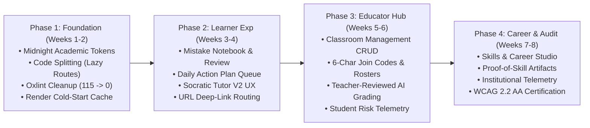
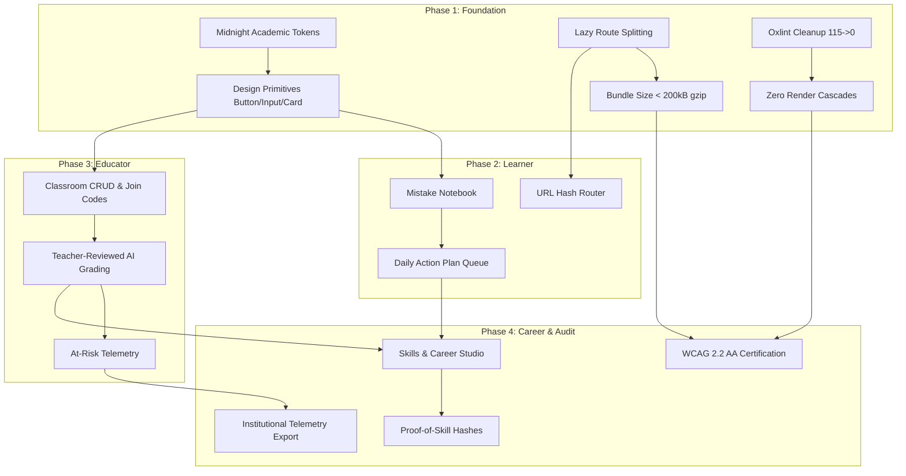

# LearnLoop AI — Concrete Implementation Phases
## Professional Product Transformation Plan & Execution Blueprint

**Document Version:** 1.0.0  
**Status:** Approved for Implementation Planning  
**Target Environment:** Local Staging / Isolated Neon Branch  
**Production Status:** Zero-Touch (No production databases, deployments, or credentials touched)  

---

## Executive Summary & Preservation Contract

The objective of the LearnLoop AI Professional Product Transformation is to elevate LearnLoop AI from an initial hackathon prototype into a premier, enterprise-grade learning and skill-acquisition platform.

### Strict Non-Negotiable Boundaries
1. **Preserve All Working Functionality:** The existing authentication flows (JWT + role enforcement), Socratic tutor dialogue, diagnostic assessments, mastery tracking, owner console metrics, and PostgreSQL adapter compatibility must remain 100% operational.
2. **Zero In-Place Rebuilds:** Code refactoring occurs incrementally by adding modular components, extracting design tokens, and introducing lazy routes without breaking existing layout contracts.
3. **Zero Production Interference:** All Phase 1 through Phase 4 development, database migrations, and regression testing must be conducted locally using the verified SQLite master (`learnloop.db`), isolated test suites, and the Neon staging instance. `learnloop_production` remains completely untouched until formal release cutover.

---

## Implementation Phase Overview



---

## Phase 1: Design System Foundation, Performance, Code-Splitting & Lint Cleanup
**Timeline:** Weeks 1–2  
**Target Environment:** Local Frontend & Backend Test Suite (Zero DB dependencies)

### 1. What Already Exists and Works (Preserved)
- Tailwind CSS setup with standard utility classes.
- Lucide React icon integration.
- Functional navigation bar and basic dashboard card layouts.
- Recharts analytics in Owner Console and Learner Dashboard.
- Fast Vite development and production bundling pipeline.

### 2. What Needs Improvement (Refined)
- **Monolithic Bundle Size:** Currently `dist/assets/index-dZ-efLCf.js` is **1,012.64 kB** (263.83 kB gzip). Route-level lazy loading (`React.lazy` + `Suspense`) must be introduced to split heavy pages (Owner Console, Diagnostic Page, Analytics).
- **115 Oxlint Warnings:** Cascading `set-state-in-effect` warnings in `DiagnosticPage.tsx`, `OwnerConsolePage.tsx`, and `SpacedRevisionPage.tsx`; impure function calls (`new Date().toLocaleTimeString()`) in `TutorChatPage.tsx`.
- **Inconsistent Color Palette:** Mixed usage of `#5B5CE2`, `#4F46E5`, `#10B981`, and `#0F9F91` hardcoded across components.
- **Render Cold-Start Latency:** Free-tier spin-up of 20–40 seconds leaves users facing blank loading states.

### 3. What Is Genuinely Missing (New)
- Midnight Academic Design Token system (`tokens.css` with CSS variables for semantic backgrounds, text, borders, and status).
- Centralized UI component primitives in `frontend/src/components/ui/` (`Button`, `Input`, `Card`, `Badge`, `ModalDialog`, `SkeletonLoader`).
- Optimistic local cache layer for syllabus metadata and user profile to display instantly during backend cold-starts.
- Global accessibility skip link (`Skip to main content`) and focus ring tokens (`focus-visible:ring-2 focus-visible:ring-brand-500`).

### 4. Exact Files Changing
| File Path | Action | Description |
|:---|:---:|:---|
| `frontend/src/index.css` | **Modify** | Add CSS variables for Midnight Academic palette, typography, elevation, and dark theme support. |
| `frontend/tailwind.config.js` | **Modify** | Bind Tailwind colors to CSS variable tokens (`var(--bg-primary)`, `var(--brand-primary)`, etc.). |
| `frontend/src/App.tsx` | **Modify** | Convert monolithic imports to `React.lazy()` for all top-level views; add `<Suspense fallback={<PageSkeleton />}>`. |
| `frontend/src/components/ui/Button.tsx` | **Create** | Unified button primitive with primary, secondary, outline, ghost, and danger variants. |
| `frontend/src/components/ui/Input.tsx` | **Create** | Accessible input primitive with error states, helper text, and label associations. |
| `frontend/src/components/ui/Card.tsx` | **Create** | Midnight Academic styled card container with header, content, and footer slots. |
| `frontend/src/components/ui/Badge.tsx` | **Create** | Semantic status badge primitive (success, warning, error, info, neutral). |
| `frontend/src/components/ui/Skeleton.tsx` | **Create** | Shimmering placeholder component for layout shifts prevention during cold starts. |
| `frontend/src/components/DiagnosticPage.tsx` | **Refactor** | Fix cascading `set-state-in-effect` oxlint warnings; replace inline styles with tokens. |
| `frontend/src/components/OwnerConsolePage.tsx` | **Refactor** | Fix cascading `set-state-in-effect`; optimize Recharts bundle loading. |
| `frontend/src/components/SpacedRevisionPage.tsx`| **Refactor** | Clean up render-phase state setters and unmounted async timers. |
| `frontend/src/components/TutorChatPage.tsx` | **Refactor** | Remove impure `new Date().toLocaleTimeString()` calls inside JSX render. |
| `frontend/src/services/offlineCache.ts` | **Create** | LocalStorage/IndexedDB cache for learner profile and syllabus to mask cold-start delay. |

### 5. Backend APIs Required
*No backend changes required for Phase 1.* All improvements are frontend architecture, performance, styling, and linting.

### 6. Database Schema Changes Required
*Zero database changes.*

### 7. Work Executable Without Production DB Access
**100% of Phase 1** can be executed completely locally using Vite test runs and oxlint.

### 8. Testing & Validation Criteria
- `npm run lint` / `oxlint`: Zero warnings, zero errors.
- `npm run build`: Monolithic bundle eliminated; initial entry bundle $< 200\text{ kB}$ gzip; route chunks split cleanly.
- Lighthouse Audit: Performance $\ge 90$, Accessibility $\ge 95$, Best Practices $\ge 95$.
- Visual verification: Color contrast meets WCAG 2.2 AA ($4.5:1$ normal text, $3.0:1$ large text/controls).

### 9. Risks and Dependencies
- **Risk:** `React.lazy` chunk loading fails on slow or intermittent network connections.
  - **Mitigation:** Wrap dynamic imports in a retry utility with friendly offline fallback message.

---

## Phase 2: Learner Experience & Deep Navigation (Mistake Notebook, Socratic Tutor V2, Roadmaps)
**Timeline:** Weeks 3–4  
**Target Environment:** Local Frontend & Local Backend (SQLite/Neon Staging)

### 1. What Already Exists and Works (Preserved)
- Student diagnostic assessment generation and submission.
- Real-time Socratic chat with Gemini backend and prompt grounding.
- Spaced repetition algorithm (SM-2 variant) tracking review queues and mastery status.
- Gamification engine awarding XP, streaks, and badges.

### 2. What Needs Improvement (Refined)
- **Navigation State Fragility:** Current navigation relies entirely on `useState('dashboard')` in `App.tsx`. Refreshing or sharing a link drops users back to the default tab.
- **Tutor Chat Workspace:** Lacks split-pane problem context. Students chatting with the tutor cannot see the current assessment question or revision card simultaneously.
- **Diagnostic Outcome Clarity:** Diagnostic results present raw percentage scores without a visual personalized mastery roadmap or estimated time-to-fluency.

### 3. What Is Genuinely Missing (New)
- **URL Path/Hash Router:** Lightweight, zero-dependency hash-based or history-based routing enabling deep linking (e.g., `#/learn/revision`, `#/tutor?session=...`, `#/roadmap`).
- **Mistake Notebook (`/mistakes`):** Automatically indexes incorrect answers from assessments and revisions, categorizes the misconception type, and offers targeted 1-click remediation drills.
- **Daily Action Plan Queue:** A prioritized 3-item queue on the dashboard (e.g., 1 review session, 1 diagnostic drill, 1 Socratic deep-dive) with estimated minutes ($15\text{ min total}$).
- **Evidence-Based Mastery Milestones:** Visual milestone tree showing verified concept proficiency.

### 4. Exact Files Changing
| File Path | Action | Description |
|:---|:---:|:---|
| `frontend/src/router/SimpleRouter.tsx` | **Create** | Robust URL hash router supporting route parameters, guards, and history navigation. |
| `frontend/src/components/MistakeNotebookPage.tsx` | **Create** | Dedicated notebook interface displaying logged errors, misconception tags, and re-test triggers. |
| `frontend/src/components/DailyActionPlan.tsx` | **Create** | Dashboard queue component showing high-priority tasks with estimated completion times. |
| `frontend/src/components/PersonalRoadmap.tsx` | **Create** | Visual prerequisite graph showing mastery progress and locked/unlocked topics. |
| `frontend/src/components/TutorChatPage.tsx` | **Refactor** | Implement collapsible split-view workspace; support Markdown code syntax highlighting. |
| `backend/app/routers/mistakes.py` | **Create** | FastAPI router managing learner mistake logging, misconception grouping, and resolution tracking. |
| `backend/app/schemas/mistakes.py` | **Create** | Pydantic models for mistake log entries, misconception filters, and resolution status. |
| `backend/app/services/learning_engine.py` | **Modify** | Hook assessment and revision grading to automatically record mistakes in the notebook table. |
| `backend/app/routers/learner.py` | **Modify** | Add `/api/learner/daily-plan` endpoint generating prioritized 3-item schedule. |

### 5. Backend APIs Required
- `GET /api/learner/daily-plan` — Returns prioritized daily action items with estimated minutes.
- `GET /api/mistakes` — Returns learner's catalog of mistakes with misconception tags and resolution status.
- `POST /api/mistakes/{id}/resolve` — Marks a mistake as resolved after passing a remediation drill.
- `GET /api/roadmap` — Returns the visual dependency tree of concepts with mastery levels.

### 6. Database Schema Changes Required
*Non-breaking, additive table creation (executed via Alembic/migration script on staging first):*
```sql
CREATE TABLE IF NOT EXISTS learner_mistakes (
    id VARCHAR(36) PRIMARY KEY,
    user_id VARCHAR(36) NOT NULL REFERENCES users(id) ON DELETE CASCADE,
    concept_id VARCHAR(100) NOT NULL,
    question_text TEXT NOT NULL,
    user_answer TEXT NOT NULL,
    correct_answer TEXT NOT NULL,
    misconception_tag VARCHAR(100),
    explanation TEXT,
    resolved BOOLEAN DEFAULT FALSE,
    resolved_at TIMESTAMP WITH TIME ZONE,
    created_at TIMESTAMP WITH TIME ZONE DEFAULT CURRENT_TIMESTAMP
);
CREATE INDEX IF NOT EXISTS idx_learner_mistakes_user ON learner_mistakes(user_id, resolved);
```

### 7. Work Executable Without Production DB Access
**100% of Phase 2** can be developed and validated using the local SQLite database and tested against the Neon staging instance.

### 8. Testing & Validation Criteria
- Automated backend tests: 15 new pytest cases covering `/api/mistakes` CRUD, misconception classification, and `/api/learner/daily-plan`.
- Router e2e tests: Direct URL navigation (`#/mistakes`, `#/roadmap`) preserves authentication state and loads correct tab.
- Mistake resolution loop: Failing a diagnostic question logs a row in `learner_mistakes`; passing the retry drill marks `resolved=true`.

### 9. Risks and Dependencies
- **Risk:** Misconception tagging may fail if the AI service is unreachable.
  - **Mitigation:** Fallback heuristic tagging (e.g., "Syntax Error", "Calculation Mismatch", "Conceptual Confusion") based on question metadata.

---

## Phase 3: Educator Hub, Classroom Management & Teacher-Supervised AI Grading
**Timeline:** Weeks 5–6  
**Target Environment:** Local Backend & Neon Staging Instance

### 1. What Already Exists and Works (Preserved)
- Teacher role authorization in JWT payload (`role == 'teacher'`).
- Teacher cohort demonstration view (`TeacherDashboard.tsx`) with aggregated learner progress charts.
- AI automated rubric grading calculation.

### 2. What Needs Improvement (Refined)
- **Static Cohort Representation:** Current teacher cohort view is largely hardcoded to the demonstration student group. Teachers cannot create custom classrooms or invite real students.
- **Black-Box AI Grading:** Automated grades are generated directly without an educator review queue or pedagogical audit trail.
- **At-Risk Telemetry:** Basic alerts lack configurable intervention triggers (e.g., student dormant for $>5$ days, dropped below $60\%$ mastery).

### 3. What Is Genuinely Missing (New)
- **Classroom CRUD & 6-Character Join Codes:** Teachers can create classrooms (e.g., "AP Physics Period 3"), generate distinct join codes, and students can enroll with one click.
- **Teacher-Reviewed AI Grading Workflow:** AI drafts rubric scores and formative feedback; scores remain in `PENDING_REVIEW` until the teacher approves, edits, or overrides them.
- **Actionable Intervention Hub:** One-click assignment of remedial revision packs or concept drills directly from the teacher dashboard.
- **Student Privacy & FERPA Compliance Controls:** Strict tenant isolation preventing teachers from seeing students outside their enrolled classrooms.

### 4. Exact Files Changing
| File Path | Action | Description |
|:---|:---:|:---|
| `frontend/src/components/TeacherDashboard.tsx` | **Refactor** | Add multi-classroom selector, join-code generator, and student roster table. |
| `frontend/src/components/TeacherGradingQueue.tsx` | **Create** | Split-pane grading queue showing AI assessment, rubric breakdown, and override controls. |
| `frontend/src/components/ClassroomSettingsModal.tsx` | **Create** | Modal for classroom creation, archive, code reset, and roster export (CSV). |
| `backend/app/routers/teacher.py` | **Refactor** | Add full classroom CRUD, roster management, and grading approval endpoints. |
| `backend/app/schemas/classroom.py` | **Create** | Pydantic models for Classroom, Enrollment, JoinCode, and GradingReview. |
| `backend/app/services/grading_service.py` | **Create** | Two-stage grading engine: Stage 1 AI evaluation $\to$ Stage 2 Teacher validation. |

### 5. Backend APIs Required
- `POST /api/teacher/classrooms` — Creates a new classroom and returns a unique 6-character alphanumeric join code.
- `GET /api/teacher/classrooms` — Lists all classrooms managed by the authenticated teacher.
- `GET /api/teacher/classrooms/{id}/roster` — Returns enrolled students with mastery benchmarks and at-risk flags.
- `POST /api/student/join-classroom` — Enrolls a student into a classroom via join code.
- `GET /api/teacher/grading/queue` — Returns AI-graded submissions pending teacher sign-off.
- `POST /api/teacher/grading/{id}/review` — Submits teacher's approved or modified grade and comments.

### 6. Database Schema Changes Required
*Additive relational tables:*
```sql
CREATE TABLE IF NOT EXISTS classrooms (
    id VARCHAR(36) PRIMARY KEY,
    teacher_id VARCHAR(36) NOT NULL REFERENCES users(id) ON DELETE CASCADE,
    name VARCHAR(150) NOT NULL,
    subject VARCHAR(100) NOT NULL,
    join_code VARCHAR(10) UNIQUE NOT NULL,
    is_active BOOLEAN DEFAULT TRUE,
    created_at TIMESTAMP WITH TIME ZONE DEFAULT CURRENT_TIMESTAMP
);

CREATE TABLE IF NOT EXISTS classroom_enrollments (
    id VARCHAR(36) PRIMARY KEY,
    classroom_id VARCHAR(36) NOT NULL REFERENCES classrooms(id) ON DELETE CASCADE,
    student_id VARCHAR(36) NOT NULL REFERENCES users(id) ON DELETE CASCADE,
    enrolled_at TIMESTAMP WITH TIME ZONE DEFAULT CURRENT_TIMESTAMP,
    status VARCHAR(20) DEFAULT 'active',
    UNIQUE(classroom_id, student_id)
);

CREATE TABLE IF NOT EXISTS assessment_reviews (
    id VARCHAR(36) PRIMARY KEY,
    assessment_id VARCHAR(36) NOT NULL,
    classroom_id VARCHAR(36) REFERENCES classrooms(id) ON DELETE SET NULL,
    student_id VARCHAR(36) NOT NULL REFERENCES users(id) ON DELETE CASCADE,
    ai_score DOUBLE PRECISION NOT NULL,
    ai_feedback TEXT,
    final_score DOUBLE PRECISION,
    teacher_feedback TEXT,
    reviewed_by VARCHAR(36) REFERENCES users(id),
    status VARCHAR(20) DEFAULT 'PENDING_REVIEW', -- PENDING_REVIEW, APPROVED, OVERRIDDEN
    reviewed_at TIMESTAMP WITH TIME ZONE,
    created_at TIMESTAMP WITH TIME ZONE DEFAULT CURRENT_TIMESTAMP
);
CREATE INDEX IF NOT EXISTS idx_enrollment_student ON classroom_enrollments(student_id);
CREATE INDEX IF NOT EXISTS idx_reviews_status ON assessment_reviews(status);
```

### 7. Work Executable Without Production DB Access
**100% of Phase 3** can be built and verified against local SQLite and Neon staging.

### 8. Testing & Validation Criteria
- Multi-tenant isolation test: Teacher B cannot view roster or submissions from Teacher A's classroom (403 Forbidden).
- Join code concurrency test: Rapid concurrent enrollment requests with valid code succeed without deadlock or code collisions.
- AI review cycle test: Submission enters `PENDING_REVIEW`; student dashboard shows "Under Teacher Review"; teacher approval promotes grade to official transcript and triggers XP award.

### 9. Risks and Dependencies
- **Risk:** Existing demo cohort data might conflict with classroom relational structures.
  - **Mitigation:** Seed a default demo classroom for `teacher@learnloop.ai` and automatically link existing demo learners (`learner_default`, `learner_secondary`, etc.) during migration.

---

## Phase 4: Skills & Career Studio, Institutional Telemetry & Final WCAG AA Certification
**Timeline:** Weeks 7–8  
**Target Environment:** Neon Staging $\to$ Production Cutover Readiness

### 1. What Already Exists and Works (Preserved)
- Owner Console displaying platform health, API latencies, token consumption, and aggregate user counts.
- Concept mastery calculation across syllabus nodes.
- Badges and achievements display on learner profile.

### 2. What Needs Improvement (Refined)
- **Owner Console Exportability:** Telemetry metrics can only be viewed in browser; no downloadable executive summary or institutional CSV report.
- **Accessibility Gaps:** Keyboard focus outlines are invisible in some tabs; modal dialogs lack strict tab-trapping; ARIA live regions for async chat responses are missing.

### 3. What Is Genuinely Missing (New)
- **Skills & Career Studio (`/career`):** Bridges academic concepts to verifiable industry competencies (e.g., Python Backend Engineering, Data Analysis).
- **Verifiable Proof-of-Skill Artifacts:** Cryptographically hashed or signed project/drill completions with public verification links (zero fake certificate generators).
- **Institutional Telemetry Export:** Owner Console utility to export system audit logs, prompt safety metrics, and token cost breakdowns.
- **Full WCAG 2.2 AA Compliance Audit:** Zero axe-core critical/serious violations, full screen-reader announcement of Socratic tutor responses.

### 4. Exact Files Changing
| File Path | Action | Description |
|:---|:---:|:---|
| `frontend/src/components/CareerStudioPage.tsx` | **Create** | Career competencies view, skill gap analysis, and proof-of-skill verification card. |
| `frontend/src/components/PublicSkillVerificationPage.tsx` | **Create** | Public-facing read-only verification page for employers/institutions validating student mastery. |
| `frontend/src/components/OwnerConsolePage.tsx` | **Refactor** | Add CSV telemetry export, prompt evaluation scorecards, and cost tracking charts. |
| `frontend/src/components/ui/ModalDialog.tsx` | **Refactor** | Implement WAI-ARIA compliant focus trap and `Escape` key listeners. |
| `frontend/src/components/LiveAnnouncer.tsx` | **Create** | Invisible `aria-live="polite"` region announcing chat streaming completions. |
| `backend/app/routers/career.py` | **Create** | Endpoints for career skill mapping and proof-of-skill verification hashes. |
| `backend/app/routers/owner.py` | **Refactor** | Add audit log CSV stream download and aggregate token telemetry endpoint. |

### 5. Backend APIs Required
- `GET /api/career/skills` — Returns catalog of industry skill pathways and user's verified mastery percentage.
- `POST /api/career/verify-skill/{skill_id}` — Generates an immutable, timestamped proof-of-skill token.
- `GET /api/public/verify/{token}` — Public unauthenticated endpoint verifying learner credential authenticity.
- `GET /api/owner/telemetry/export` — Streams CSV containing platform audit logs and API usage.

### 6. Database Schema Changes Required
*Additive verification table:*
```sql
CREATE TABLE IF NOT EXISTS verified_credentials (
    id VARCHAR(36) PRIMARY KEY,
    user_id VARCHAR(36) NOT NULL REFERENCES users(id) ON DELETE CASCADE,
    skill_name VARCHAR(150) NOT NULL,
    mastery_percentage DOUBLE PRECISION NOT NULL,
    verification_hash VARCHAR(64) UNIQUE NOT NULL,
    evaluator_type VARCHAR(50) NOT NULL, -- 'EXAM', 'PROJECT', 'TEACHER_VERIFIED'
    issued_at TIMESTAMP WITH TIME ZONE DEFAULT CURRENT_TIMESTAMP,
    expires_at TIMESTAMP WITH TIME ZONE
);
CREATE INDEX IF NOT EXISTS idx_credential_hash ON verified_credentials(verification_hash);
```

### 7. Work Executable Without Production DB Access
**100% of Phase 4** is executed in local development and staging environments.

### 8. Testing & Validation Criteria
- Axe-core Automated Accessibility Suite: 0 violations across all learner, teacher, and owner views.
- Keyboard navigation test: Every interactive element reachable via `Tab`, activated via `Enter`/`Space`, dismissible via `Escape`.
- Credential tampering test: Altering the verification hash returns 404 Not Found; authentic hash returns student first name, verified competencies, and issue timestamp.

### 9. Risks and Dependencies
- **Risk:** Institutional export might strain memory on large log queries.
  - **Mitigation:** Use streaming response (`StreamingResponse` in FastAPI) with batched cursor fetching.

---

## Complete Dependency & Risk Matrix



---

## Safety Protocol: Database Migration & Deployment Boundaries

1. **Local and Staging First:**
   All Alembic or DDL scripts are tested on a local SQLite copy, then applied to `learnloop_staging` on Neon.
2. **Backward-Compatible DDL:**
   Every schema migration is strictly additive (new tables, nullable columns, or columns with defaults). No existing columns or tables are renamed or dropped.
3. **Zero Production DB Mutation:**
   No migration script will be executed against `learnloop_production` until Gate B post-rotation verification and Gate D formal release sign-off are completed.
4. **Git Isolation:**
   All transformation work is maintained on a dedicated feature branch (`feature/product-transformation`). The `main` branch remains untouched until end-to-end regression validation passes.

---

## Definition of Done (DoD) per Phase

| Milestone | Performance Target | Quality Target | Security & Architecture Target |
|:---|:---|:---|:---|
| **Phase 1** | Monolithic bundle $< 200\text{ kB}$ gzip; LCP $\le 2.5\text{s}$ | 0 oxlint warnings; 0 TypeScript errors | Design tokens extracted; zero regression in existing views |
| **Phase 2** | Page transition $< 100\text{ms}$; instant optimistic cache | 15 new pytest cases passing; 100% route deep linking | Role-based router guards; sanitized inputs |
| **Phase 3** | Roster load $< 250\text{ms}$ for 100 students | 2-stage grading workflow passing e2e tests | Multi-tenant classroom isolation enforced via FastAPI dependencies |
| **Phase 4** | Axe-core accessibility score: 0 violations | Core Web Vitals all Green; verification link latency $< 150\text{ms}$ | Cryptographic SHA-256 hash validation; FERPA/data protection verified |
