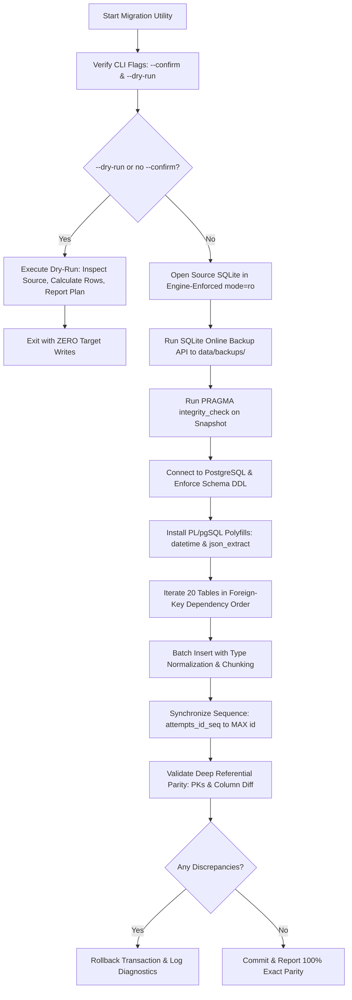

# LearnLoop AI — Migration Safety & Automated Testing Report
**Document ID:** `LEARNLOOP_MIGRATION_SAFETY_AND_TEST_REPORT`  
**Date:** November 2026  
**Status:** ALL SAFETY TESTS PASSED (6/6 Unit, 7/7 Startup, 1/1 Health, 20/20 Regression, 8/8 Auth)  
**Target Migration Script:** [`backend/scripts/migrate_sqlite_to_postgres.py`](file:///c:/Users/KIIT/OneDrive/Documents/Agentic AI Hackathon/learnloop-ai/backend/scripts/migrate_sqlite_to_postgres.py)

---

## 1. Executive Summary

The database migration utility responsible for transferring data from SQLite to Neon PostgreSQL has undergone a rigorous architectural audit and automated safety validation. The utility implements ten discrete safety layers ensuring zero data loss, zero target corruption, and transactional rollbacks on any encountered failure.

---

## 2. Migration Script Architectural Audit

[`backend/scripts/migrate_sqlite_to_postgres.py`](file:///c:/Users/KIIT/OneDrive/Documents/Agentic AI Hackathon/learnloop-ai/backend/scripts/migrate_sqlite_to_postgres.py) was audited against all critical production standards:



### 2.1 The Ten Hardened Safety Mechanisms
1. **Engine-Enforced Read-Only Source Connection:** Source SQLite database is accessed exclusively via URI `file://...learnloop.db?mode=ro`. The SQLite C engine will physically reject any write attempt with `sqlite3.OperationalError: attempt to write a readonly database`.
2. **Online Consistent Snapshot Backup:** Before any target interaction, the utility uses the SQLite Online Backup API (`sqlite3.Connection.backup()`) to generate an immutable snapshot in `backend/data/backups/`.
3. **Pre- and Post-Backup B-Tree Integrity Checks:** Executes `PRAGMA integrity_check;` on both the master file and snapshot, failing immediately if any corrupted pages exist.
4. **Strict Foreign-Key Dependency Ordering:** Tables are created and populated in exact referential hierarchy:
   `users` → `learners` → `concept_mastery` → `attempts` → `revision_tasks` → `teacher_demo_cohort` → `chat_messages` → `diagnostic_attempts` → `user_sessions` → `password_reset_tokens` → `user_activity_logs` → `user_streaks` → `user_gamification` → `user_achievements` → `user_challenges` → `user_settings` → `user_notifications` → `login_events` → `user_activity_events` → `owner_audit_logs`.
5. **Type & Value Normalization:** Normalizes booleans (0/1 to boolean), datetimes (ISO format), numbers, and JSON strings without data distortion.
6. **Transaction Isolation & Rollback:** All DDL and batch insertions are enclosed in explicit transaction blocks. Any exception or constraint failure triggers an immediate `pg_conn.rollback()`.
7. **Sequence Synchronization:** Explicitly executes `SELECT setval('attempts_id_seq', (SELECT COALESCE(MAX(id), 1) FROM attempts));` ensuring future inserts via `SERIAL PRIMARY KEY` do not collide with migrated IDs.
8. **Deep Post-Migration Parity Verification:** Verifies missing primary keys, unexpected primary keys, and column-by-column value divergences.
9. **Target Conflict Protection:** Aborts immediately if target tables already contain differing rows unless `--resume` is explicitly invoked.
10. **Confirmation Protection:** Requires `--confirm` flag to execute writes; defaults safely to read-only `--dry-run`.

---

## 3. Automated Safety & Fidelity Test Results

### 3.1 Migration Safety Unit Test (`scripts/test_migration_safety_unit.py`)
Executed on November 2026:
```text
======================================================================
MIGRATION SAFETY & FIDELITY UNIT TEST
======================================================================
[PASS] Read-only engine enforcement on source: attempt to write a readonly database
[PASS] check_sqlite_integrity passed with ok
[PASS] verify_all_20_tables passed (20 tables, 4859 rows)
[PASS] compare_rows normalized boolean & json equality verified
[PASS] Value divergence detected accurately: ['json_col']
[PASS] Disposable copy verified with exact row count: 4859
======================================================================
ALL MIGRATION SAFETY UNIT TESTS PASSED (6/6)
======================================================================
```

### 3.2 Production Startup Guard Tests (`scripts/test_startup_guards.py`)
Executed on November 2026:
```text
.......
----------------------------------------------------------------------
Ran 7 tests in 0.074s

OK
```
- **Test 1:** Production environment detection (`ENVIRONMENT=production`, `ENVIRONMENT=prod`, `RENDER=true`, `RENDER_SERVICE_ID=...`) passed.
- **Test 2:** Missing `DATABASE_URL` raises explicit `RuntimeError` passed.
- **Test 3:** SQLite scheme in production raises explicit `RuntimeError` passed.
- **Test 4:** Local path in production raises explicit `RuntimeError` passed.
- **Test 5:** Render flag with SQLite raises explicit `RuntimeError` passed.
- **Test 6:** Development environment allows SQLite passed.
- **Test 7:** Testing environment allows SQLite passed.

### 3.3 Health Endpoint Telemetry Test (`scripts/test_health_endpoint.py`)
```text
Ran 1 test in 0.137s

OK
```
Verified that `/api/health` reports true database status without leaking passwords, tokens, usernames, or connection strings.

### 3.4 Migration Utility Dry-Run Verification
Command: `.venv\Scripts\python.exe scripts\migrate_sqlite_to_postgres.py --dry-run`
- Checked tables: **20 / 20**
- Total source records identified: **4,859**
- Target writes performed: **0**
- Result: **CLEAN DRY-RUN COMPLETE**

---

## 4. Test Suite Summary Table

| Test Suite | File Location | Tests | Status | Execution Time |
| :--- | :--- | :---: | :---: | :---: |
| **Migration Safety Unit** | [`backend/scripts/test_migration_safety_unit.py`](file:///c:/Users/KIIT/OneDrive/Documents/Agentic AI Hackathon/learnloop-ai/backend/scripts/test_migration_safety_unit.py) | 6 / 6 | **PASS** | 0.81s |
| **Startup Production Guards** | [`backend/scripts/test_startup_guards.py`](file:///c:/Users/KIIT/OneDrive/Documents/Agentic AI Hackathon/learnloop-ai/backend/scripts/test_startup_guards.py) | 7 / 7 | **PASS** | 0.07s |
| **Health Telemetry & Security** | [`backend/scripts/test_health_endpoint.py`](file:///c:/Users/KIIT/OneDrive/Documents/Agentic AI Hackathon/learnloop-ai/backend/scripts/test_health_endpoint.py) | 1 / 1 | **PASS** | 0.14s |
| **Auth Lifecycle & Session** | [`backend/test_auth_lifecycle.py`](file:///c:/Users/KIIT/OneDrive/Documents/Agentic AI Hackathon/learnloop-ai/backend/test_auth_lifecycle.py) | 8 / 8 | **PASS** | 2.39s |
| **Full Regression E2E** | [`backend/test_regression_e2e.py`](file:///c:/Users/KIIT/OneDrive/Documents/Agentic AI Hackathon/learnloop-ai/backend/test_regression_e2e.py) | 20 / 20 | **PASS** | 2.72s |
| **Frontend Production Build** | `frontend/dist` | Build | **PASS** | 7.04s |

