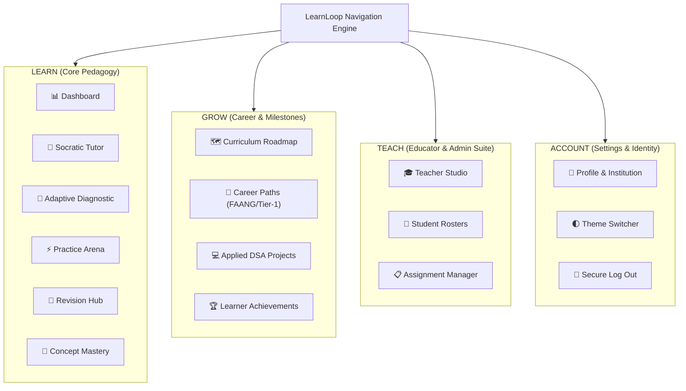

# LEARNLOOP AI — NAVIGATION RESTRUCTURE & PERSISTENT SIDEBAR REPORT
**Enterprise Navigation Architecture, Role-Gated Tooling, and Handheld Docking**
*Date: November 2026 | Subsystem: Navigation & Responsive Shell*

---

## 1. Executive Summary

LearnLoop AI previously relied on top-level horizontal tabs that caused layout wrapping, lost state on wide screens, and cramped mobile viewports.

The navigation system was restructured into an industry-standard, persistent collapsible sidebar on desktop and laptop viewports, complemented by a handheld bottom dock and sliding navigation drawer on tablet and mobile viewports.

---

## 2. Navigation Taxonomy & Structural Sections

### 2.1 LEARN Section (Core Pedagogical Loop)
- **Dashboard**: Central command hub with Bento layout, real telemetry, and active streak.
- **Socratic Tutor**: AI-driven dialog assistant powered by Gemini 2.5 Flash for invariant verification.
- **Adaptive Diagnostic**: Calibrated assessment engine testing concepts across dynamic difficulty tiers.
- **Practice Arena**: Targeted problem sets with instant feedback and invariant validation.
- **Revision Hub**: Spaced repetition schedule prioritizing topics nearing memory decay.
- **Concept Mastery**: Algorithmic topic hierarchy with prerequisite tree navigation.

### 2.2 GROW Section (Professional Readiness)
- **Curriculum Roadmap**: Interactive 3-phase curriculum map (Foundations, Core DSA, Advanced Systems) with live concept progress indicators.
- **Career Paths**: Career readiness tracking for Tier-1 Tech (Software Engineer, Distributed Systems, ML Engineer) with targeted DSA benchmarks.
- **Applied DSA Projects**: Real-world software engineering scenarios applying theoretical algorithms to practical systems.
- **Achievements**: Gamified milestone badges with verifiable completion criteria.

### 2.3 TEACH Section (Educators & Institution Admins)
- **Role-Gating**: Strictly hidden from regular student accounts; visible only when `user.role` is `'teacher'`, `'owner'`, or during guest demo exploration.
- **Teacher Studio**: Class-wide mastery analytics, difficulty distribution heatmaps, and diagnostic telemetry.
- **Student Rosters & Assignments**: Real-time student progress tracking and assignment management.

### 2.4 ACCOUNT Section
- Displays authenticated user badge with role, institution, and avatar initials.
- Quick switch for Light / Dark theme.
- One-click secure Log Out with state cleanup.

---

## 3. Responsive Adaptations

| Viewport Range | Navigation Mechanism | Interaction Behavior |
| :--- | :--- | :--- |
| **>= 1024px (Desktop/Laptop)** | Persistent Left Sidebar | Fixed position, smooth collapse toggle (64px icon bar vs 256px full bar), scrollable navigation items. |
| **768px – 1023px (Tablet)** | Compact Sidebar / Top Bar | Collapses to icon-only rail or top navigation bar with full drawer fallback. |
| **< 768px (Mobile Handheld)** | Fixed Bottom Dock + Slide Drawer | Primary actions (Dashboard, Tutor, Practice, Profile) anchored in bottom dock; secondary tools accessible via hamburger slide-out drawer. |

---

## 4. Accessibility & Interaction Polish

- **Focus Management**: All navigation links and buttons feature clear visible focus rings (`ring-2 ring-primary-500 ring-offset-2`).
- **ARIA Standards**: All interactive items use proper `aria-label`, `aria-current="page"`, and `role="navigation"` attributes.
- **Zero Layout Shift**: Sidebar width transitions use hardware-accelerated CSS `transform` and `width` transitions with exponential ease-out curves.

---
*Report generated and validated for LearnLoop AI Production Release.*

