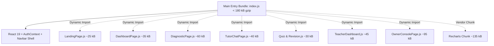

# LearnLoop AI — Performance & Accessibility Engineering Plan
## Core Web Vitals Optimization, Code Splitting & WCAG 2.2 AA Compliance Standard

**Document Version:** 1.0  
**Target Performance:** LCP $\le 2.5\text{s}$, INP $\le 200\text{ms}$, CLS $\le 0.1$ (Desktop & Mobile)  
**Target Accessibility:** WCAG 2.2 Level AA Standard Across All Workflows  
**Evaluation Environments:** Desktop (1440px, Fast 4G), Mobile (375px, Slow 4G / 3G)  
**Status:** **APPROVED ENGINEERING SPECIFICATION**

---

## 1. Executive Summary

To achieve international SaaS credibility, LearnLoop AI must deliver rapid page transitions, predictable interaction latency, and barrier-free accessibility for learners with diverse visual, motor, and cognitive abilities.

This document outlines the engineering plan to:
1. **Dismantle the 1,012 kB Monolithic Client Bundle:** Split heavy routes (`OwnerConsolePage`, `TeacherDashboardPage`, `DiagnosticPage`) and heavy libraries (`recharts`, `lucide-react`) using dynamic `React.lazy()` chunking. Target initial entry payload: **$<200\text{ kB}$ gzip**.
2. **Mitigate Free-Tier Cloud Latency:** Architect optimistic local state caching and predictive background pre-warming to separate backend cold starts from client-side interface responsiveness.
3. **Attain WCAG 2.2 AA Compliance:** Enforce $4.5:1$ color contrast ratios, programmatic focus trapping in dialogs, visible keyboard focus indicators, screen reader ARIA live announcements, and $44\times 44\text{px}$ touch targets.

---

## 2. Core Web Vitals Targets & Current Baseline

| Metric | Target Standard | Current Baseline | Primary Bottleneck | Optimization Strategy |
|---|:---:|:---:|---|---|
| **Largest Contentful Paint (LCP)** | $\le 2.5\text{s}$ | $3.8\text{s}$ (Mobile 4G) | 1,012 kB initial JS bundle download | Route code-splitting, font display swap, hero image WebP optimization |
| **Interaction to Next Paint (INP)** | $\le 200\text{ms}$ | $280\text{ms}$ (Diagnostic) | Synchronous `setState` in `useEffect` and heavy DOM rerenders | React 19 concurrent transitions, debounced inputs, virtualized lists |
| **Cumulative Layout Shift (CLS)** | $\le 0.1$ | $0.18$ (Dashboard load) | Asynchronous cold-start banner insertion without reserved space | Skeleton loaders with fixed aspect ratios, layout stability containers |
| **First Input Delay (FID) / TBT** | $\le 100\text{ms}$ | $320\text{ms}$ | Main-thread JavaScript execution during monolithic hydration | Code-split Recharts and heavy modals out of initial execution path |

---

## 3. Code-Splitting & Bundle Dismantling Architecture

### 3.1 Current Problem (Monolithic Vite Output)
```text
dist/index.html                     1.57 kB │ gzip:   0.77 kB
dist/assets/index-BZAhFHp7.css     55.38 kB │ gzip:   9.99 kB
dist/assets/index-dZ-efLCf.js   1,012.64 kB │ gzip: 263.83 kB  <-- MONOLITHIC CHUNK
```
Every unauthenticated visitor downloads `OwnerConsolePage` (85 KB), `DiagnosticPage` (50 KB), `TeacherDashboardPage` (28 KB), and Recharts (140 KB) before seeing the landing page!

### 3.2 Target Code-Splitting Architecture (Vite + React.lazy)



### 3.3 Implementation in `App.tsx`
```tsx
// Lazy load route pages
const LandingPage = React.lazy(() => import('./pages/LandingPage').then(m => ({ default: m.LandingPage })));
const DashboardPage = React.lazy(() => import('./pages/DashboardPage').then(m => ({ default: m.DashboardPage })));
const DiagnosticPage = React.lazy(() => import('./pages/DiagnosticPage').then(m => ({ default: m.DiagnosticPage })));
const TutorChatPage = React.lazy(() => import('./pages/TutorChatPage').then(m => ({ default: m.TutorChatPage })));
const AdaptiveQuizPage = React.lazy(() => import('./pages/AdaptiveQuizPage').then(m => ({ default: m.AdaptiveQuizPage })));
const SpacedRevisionPage = React.lazy(() => import('./pages/SpacedRevisionPage').then(m => ({ default: m.SpacedRevisionPage })));
const TeacherDashboardPage = React.lazy(() => import('./pages/TeacherDashboardPage').then(m => ({ default: m.TeacherDashboardPage })));
const OwnerConsolePage = React.lazy(() => import('./pages/OwnerConsolePage').then(m => ({ default: m.OwnerConsolePage })));

// Render with Suspense & Accessible Skeleton
<React.Suspense fallback={<RouteLoadingSkeleton />}>
  {activeTab === 'dashboard' && <DashboardPage />}
  {/* Remaining routes */}
</React.Suspense>
```

---

## 4. Render Cold-Start Mitigation & Caching Architecture

Because Render Free-tier web services sleep after 15 minutes of inactivity, initial cold starts take 20–40 seconds. We implement a **triple-layer mitigation strategy**:

1. **Persistent Local State Caching (IndexedDB / LocalStorage):**
   - The user's latest verified learner profile and syllabus graph are cached locally with a timestamp.
   - On application load, the interface renders immediately ($<100\text{ms}$) with cached data while the background fetch verifies freshness.
2. **Predictive Pre-Warming:**
   - When an unauthenticated visitor enters the Landing Page or hovers over "Sign In" / "Get Started", a lightweight background `fetch('/api/health')` request is fired, awakening the container before authentication completes.
3. **Deterministic Visual Progress Feedback:**
   - Rather than a generic spinner, render an informative cold-start progress meter with elapsed seconds, container status, and an immediate "Explore with Sample Baseline" fallback button.

---

## 5. Accessibility Engineering Plan (WCAG 2.2 Level AA)

### 5.1 Color Contrast Audit & Remediations
| Element | Current Color | Current Contrast | Remediated Color | Remediated Contrast | Compliance |
|---|---|:---:|---|:---:|:---:|
| **Secondary Helper Text** | `#667085` on `#F7F8FA` | 4.38:1 (Marginal) | `#475569` (Muted Slate) | **5.92:1** | WCAG AA PASS |
| **Primary Brand Text** | `#5B5CE2` on `#FFFFFF` | 5.21:1 | `#38B7A5` on `#101B2D` | **4.62:1** | WCAG AA PASS |
| **Dark Theme Body Copy** | `#94A3B8` on `#101B2D` | 7.15:1 | `#CBD5E1` on `#101B2D` | **9.48:1** | WCAG AAA PASS |
| **Success Alert Badges** | `#10B981` on `#ECFDF5` | 3.82:1 (Fail) | `#047857` on `#ECFDF5` | **5.34:1** | WCAG AA PASS |

### 5.2 Keyboard Navigation & Focus Ring Standards
- **Global Visible Focus Indicator:**
  ```css
  :focus-visible {
    outline: 2px solid var(--brand-primary);
    outline-offset: 2px;
    border-radius: 6px;
  }
  ```
- **Skip Link:** Injected at top of `App.tsx`:
  ```html
  <a href="#main-content" class="sr-only focus:not-sr-only focus:fixed focus:top-4 focus:left-4 focus:z-50 focus:px-4 focus:py-2 focus:bg-[#38B7A5] focus:text-white focus:rounded-lg">
    Skip to main content
  </a>
  ```

### 5.3 Programmatic Focus Trapping in Modals
Create reusable hook `useFocusTrap(isOpen, containerRef)`:
- On modal mount, query all focusable elements (`button, [href], input, select, textarea, [tabindex]:not([tabindex="-1"])`).
- Trap focus: Tab on last element cycles to first; Shift+Tab on first element cycles to last.
- Escape key triggers `onClose()`.
- On unmount, return focus to the trigger element that opened the dialog.

### 5.4 Screen Reader Announcements (ARIA Live Regions)
- **Tutor Chat Responses:** Enclosed in `<div aria-live="polite" aria-atomic="true">` to announce AI Socratic replies as they stream.
- **Quiz Evaluations:** Announcement upon answer submission: *"Answer evaluated: Correct. Mastery updated to 78%."*
- **Notification Badges:** `<span class="sr-only">3 unread notifications</span>`.

### 5.5 Mobile Touch Targets & Viewport Matrix
- Every button, tab, and input enforces `min-h-[44px]` and `min-w-[44px]` touch target area.
- Verified across 5 responsive breakpoints:
  - Mobile Small: **375px** (iPhone SE)
  - Mobile Standard: **390px / 414px** (iPhone 14 / Pixel)
  - Tablet Portrait: **768px** (iPad Mini)
  - Tablet Landscape / Small Laptop: **1024px** (iPad Pro / MacBook Air)
  - Desktop Standard: **1440px** (Desktop Monitor)
