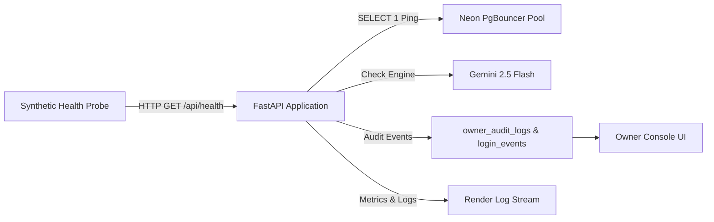

# LearnLoop AI — Phase 2.6: Production Monitoring & Observability Plan

**Document Version:** 1.0  
**Target Environment:** Render Production Backend & Neon Serverless PostgreSQL  
**Monitoring Scope:** Application Health, Database Pool, API Performance, Security Telemetry

---

## 1. Observability Architecture Overview

The LearnLoop AI production observability framework covers four operational pillars:
1. **Application Health & Synthetics:** Automated endpoint monitoring via `/api/health`.
2. **Database Connection Pool & Latency:** Neon connection tracking, pool saturation, and query latency.
3. **Pedagogical & AI Engine Reliability:** Gemini 2.5 Flash latency, rate limits, and deterministic fallback.
4. **Security & Identity Auditing:** Owner Console audit trail, brute force rate-limit tracking, and log sanitation.



---

## 2. Health Check Telemetry (`/api/health`)

### 2.1 Endpoint Specification
- **URL:** `https://learnloop-ai-backend.onrender.com/api/health`
- **Method:** `GET`
- **Authentication:** Public (No Bearer token required)
- **Response Format:** JSON
- **Frequency:** Every 60 seconds (external synthetic monitor, e.g., BetterStack, UptimeRobot, or Cloudflare Healthchecks).

### 2.2 Expected Payload & Key Interpretations
```json
{
  "status": "healthy",
  "service": "LearnLoop AI Adaptive Tutor",
  "version": "1.0.0",
  "engine": {
    "provider": "Gemini AI API",
    "is_ai_configured": true,
    "model": "gemini-2.5-flash",
    "fallback_available": true
  },
  "syllabus": {
    "name": "Introductory Data Structures & Algorithms",
    "concepts_count": 12,
    "concepts": ["array_basics", "dynamic_arrays", "singly_linked_lists", "..."]
  },
  "features": {
    "diagnostic_test": "active",
    "interactive_concept_graph": "active",
    "persistent_learner_model": "active",
    "adaptive_question_generator": "active",
    "misconception_detection": "active",
    "spaced_repetition": "active"
  }
}
```

### 2.3 Health Evaluation Matrix

| Observation | Status Classification | Immediate Operational Action |
|---|---|---|
| HTTP 200, `"status": "healthy"`, `"is_ai_configured": true` | **GREEN (Optimal)** | Normal operation. |
| HTTP 200, `"is_ai_configured": false`, `"provider": "Deterministic..."` | **YELLOW (Degraded)** | AI key missing or expired; fallback pedagogical engine active. |
| HTTP 500 or Connection Timeout (> 10s) | **RED (Critical)** | Container crashed, pool exhausted, or Render spin-up failure. Trigger alert. |

---

## 3. Database Connection Pool & Performance Monitoring

### 3.1 Connection Architecture
LearnLoop AI utilizes `ThreadedConnectionPool` configured in `backend/app/storage/db.py`:
- **Default Min Connections (`DB_POOL_MIN`):** 2
- **Default Max Connections (`DB_POOL_MAX`):** 10
- **Stale Socket Detection:** Every connection checkout executes a fast `SELECT 1` ping. If broken, the socket is cleanly discarded via `putconn(conn, close=True)` and a fresh socket is instantiated.

### 3.2 Performance SLA Thresholds

| Metric | Target SLA | Warning Threshold | Critical Incident Threshold |
|---|---|---|---|
| Database Query Latency (P95) | < 50ms | > 150ms | > 500ms |
| AI Tutor Socratic Generation (P95) | < 1.8s | > 3.0s | > 6.0s |
| Connection Pool Saturation | < 50% (5/10) | > 80% (8/10) | 100% (10/10 Exhaustion) |
| Server 5xx Error Rate | < 0.1% | > 1.0% | > 3.0% over 5-minute window |

### 3.3 Connection Pool Exhaustion Mitigation Runbook
If Render logs display `pool exhausted` or `psycopg2.pool.PoolError`:
1. Check Render metrics for spikes in concurrent active requests.
2. Temporarily increase `DB_POOL_MAX=15` in Render environment variables.
3. Verify that all route handlers use context managers (`with storage.get_connection() as conn:`) to prevent connection leaks. (Audited in Phase 2.2: 100% of routes use context managers).

---

## 4. Security Audit & Credential Protection

### 4.1 Log Sanitization Standards
To comply with zero-trust logging requirements:
- **No Database DSNs:** The connection string `postgresql://...` must NEVER appear in stdout logs or client responses. The code emits sanitized notices: `[STORAGE ACTIVE] Initialized Neon/PostgreSQL connection pool (min=2, max=10)`.
- **No Password Hashes:** Export endpoints (`/api/owner/export/*`) strictly strip `hashed_password`, `google_sub`, and refresh token hashes from output CSVs.
- **No Tutor Transcripts in Exports:** Private pedagogical reasoning and student chat transcripts are omitted from administrative exports.

### 4.2 Rate Limiting & Threat Telemetry
- **Owner Login Protection:** Maximum 5 failed attempts per 15 minutes per IP/email.
  - Exceeding limit triggers HTTP 429 and emits an audit event with action `OWNER_LOGIN_RATE_LIMITED`.
- **Token Invalidation:** User session rotation revokes old tokens with a 60-second grace window to allow concurrent client tab updates without security degradation.

---

## 5. Incident Response Playbook

| Scenario | Symptoms | Action Runbook |
|---|---|---|
| **Neon PostgreSQL Outage** | 500 errors on database routes, `psycopg2.OperationalError` in logs. | 1. Check [Neon Status](https://status.neon.tech).<br>2. If prolonged (> 15m), initiate Phase 2.5 Rollback Runbook to restore SQLite. |
| **Gemini AI API Throttling** | Slow responses (> 5s) on `/api/tutor/chat`, 429 from Google API. | 1. LearnLoop automatically falls back to deterministic rule-based Socratic engine.<br>2. Check Google Cloud Console API quotas. |
| **Render Container Sleep / Cold Start** | Initial request takes 30–45s before returning HTTP 200. | 1. Expected behavior on Render free tier.<br>2. For zero cold starts, configure a scheduled ping every 10 minutes via cron or external uptime check. |

---

## 6. Phase 2.6 Sign-off

- [x] Synthetic health probe defined for `/api/health`.
- [x] Database connection pool metrics and stale socket handling documented.
- [x] SLA thresholds defined for P95 latency and 5xx error rates.
- [x] Log sanitization and credential masking standards verified.
- [x] Incident response playbooks defined for database and AI engine failovers.
- [x] **Conclusion:** Ready for Final Production Readiness Synthesis.

