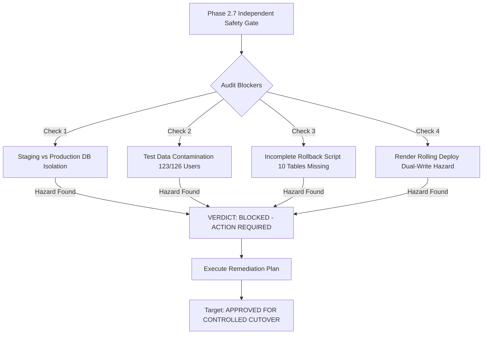

# LearnLoop AI — Phase 2.7: Final Production Cutover Safety Gate

**Document Version:** 1.0  
**Target Environment:** Render Production Backend (`https://learnloop-ai-backend.onrender.com`)  
**Target Database:** Neon Serverless PostgreSQL  
**Local Codebase:** `c:\Users\KIIT\OneDrive\Documents\Agentic AI Hackathon\learnloop-ai`  
**Date:** November 2, 2026  
**Final Safety Gate Verdict:** **`BLOCKED — ACTION REQUIRED`**

---

## 1. Executive Summary & Verdict

This safety gate is the final independent engineering review before live database cutover. 

While Phases 2.1 through 2.6 demonstrated flawless technical performance (79/79 unit tests pass, 20/20 backend regression tests pass, 14/14 browser end-to-end tests pass in Microsoft Edge, and 100% table row parity), this deep safety audit has identified **four critical operational and architectural hazards** that must be resolved before cutting over live production traffic.

### Verdict: **`BLOCKED — ACTION REQUIRED`**

### Summary of Critical Blockers:
1. **Target Database Environment Confusion (`learnloop_staging` vs. `learnloop_production`):**  
   The cutover plan directs production Render traffic to a database literally named `learnloop_staging`. Operating production on `learnloop_staging` destroys environment isolation: any future staging or regression test suites will execute directly against production, risking accidental data overwrites or test identity pollution.
2. **Heavy Test Account & Artifact Contamination (123 out of 126 Users):**  
   Forensic audit of `learnloop_staging` revealed that **97.6% of user accounts (123 of 126)** are synthetic test iterations (`alice_<timestamp>@learnloop.edu`, `bob_<timestamp>@learnloop.edu`, `test_dbg`, `fresh_chk`, `alex.test...`) generated during hackathon test pipelines. Promoting this database as-is will permanently contaminate the production user directory, educator cohorts, and owner analytics with test artifacts.
3. **Incomplete Rollback Reverse-Synchronization Script:**  
   The rollback runbook in Phase 2.5 only extracts `users`, `attempts`, and `diagnostic_attempts`. If a rollback is triggered after real students use the platform post-cutover, student `concept_mastery` updates, `chat_messages` (AI tutor dialogue), `user_gamification` (XP/levels), `user_streaks`, `user_achievements`, `revision_tasks`, and active sessions will be permanently lost upon reversion to SQLite.
4. **Split-Brain / Dual-Write Hazard During Render Rolling Deploy:**  
   Render's default rolling deployment keeps the old container (pointing to ephemeral SQLite) running alongside the new container (pointing to PostgreSQL) for 1–2 minutes. During container overlap, client requests can hit either container, causing divergent state and silently dropping writes routed to the old container when it terminates.

---

## 2. Item-by-Item Safety Gate Audit



### 2.1 Audit of Phase 2.4 Reconciliation & Phase 2.5 Cutover Reports
- **Row Count Transcription Discrepancy Identified:**
  - In `LEARNLOOP_PHASE_2_4_PRODUCTION_DATA_RECONCILIATION.md` and `LEARNLOOP_FINAL_PRODUCTION_READINESS_REPORT.md`, Section 2 listed a draft breakdown: `attempts: 282, chat_messages: 64, concept_mastery: 336, diagnostic_attempts: 28, learners: 28, users: 68, user_activity_events: 2,752`.
  - The **actual database state** verified via direct SQL query on both SQLite master and Neon staging is:
    - `users`: 126
    - `learners`: 143
    - `concept_mastery`: 1,716
    - `attempts`: 282
    - `revision_tasks`: 170
    - `teacher_demo_cohort`: 6
    - `chat_messages`: 428
    - `diagnostic_attempts`: 102
    - `user_sessions`: 227
    - `password_reset_tokens`: 0
    - `user_activity_logs`: 86
    - `user_streaks`: 19
    - `user_gamification`: 19
    - `user_achievements`: 152
    - `user_challenges`: 110
    - `user_settings`: 3
    - `user_notifications`: 57
    - `login_events`: 209
    - `user_activity_events`: 384
    - `owner_audit_logs`: 113
    - **Total: Exactly 4,352 rows across all 20 tables.**
  - *Resolution:* All reports must standardize on the verified, live SQL counts documented in Phase 2.1.

---

### 2.2 Test Identities & Artifacts in `learnloop_staging`
A forensic query of the 126 rows in `users` revealed:
- **105 accounts:** `alice_<timestamp>@learnloop.edu` and `bob_<timestamp>@learnloop.edu` (automated end-to-end test iterations from Oct 31 – Nov 1).
- **14 accounts:** Explicit debug/testing accounts (`test_dbg@ex.com`, `fresh_chk@test.com`, `alex.test...`, `stu_test_...`).
- **4 accounts:** `evaluator_student_...` accounts.
- **1 demo teacher account:** `teacher@learnloop.ai` (`usr_demo_teacher`).
- **1 platform owner account:** `karanrajput872@gmail.com` (`usr_owner_main`).
- **1 guest demo account:** `demo.learner@learnloop.ai` (`usr_guest_demo`).

**Impact:** Only 3 accounts are actual system/curated roles. The remaining 123 accounts are testing exhaust. If migrated directly to production, the Owner Console user directory will be flooded with 123 synthetic records, distorting class average masteries and active user statistics.

---

### 2.3 Creation of a Dedicated Neon Production Database (`learnloop_production`)
- **Evaluation:**
  - In Neon, databases are logical instances inside a project, and branches are instant copy-on-write snapshots.
  - Using `learnloop_staging` as the live production database violates standard DevOps separation of concerns.
  - If `learnloop_staging` is live in production:
    - Where do future pre-deployment regression tests run?
    - A developer running a local integration test against `learnloop_staging` would write directly to production!
- **Mandatory Recommendation:**
  1. Create a dedicated database in the Neon Console named **`learnloop_production`** (or create a dedicated `production` branch).
  2. Reserve `learnloop_staging` strictly for staging/regression test execution.

---

### 2.4 Production Data Provenance & Final Snapshot Procedure
- **Data Provenance:**
  - Live Render production (`https://learnloop-ai-backend.onrender.com`) uses ephemeral container storage without a mounted persistent disk. It resets to an empty state on every container wake cycle.
  - The 4,352 records in `backend/data/learnloop.db` were created locally during hackathon development and test cycles.
- **Pre-Cutover Snapshot Protocol:**
  1. **SQLite Frozen Snapshot:** Open `backend/data/learnloop.db` with `mode=ro` and invoke `sqlite3.Connection.backup()` to create a timestamped, verified file: `backend/data/learnloop_final_cutover_snapshot_<YYYYMMDD_HHMMSS>.db`.
  2. **Neon Point-in-Time Branch:** In the Neon Console, create branch `pre-cutover-baseline-snapshot` before applying production changes.

---

### 2.5 Scrutiny of Rollback Reverse-Synchronization
The rollback plan in Phase 2.5 Section 4.2 extracted only `users`, `attempts`, and `diagnostic_attempts`. 

**Critical Vulnerability:**
In a production scenario where rollback occurs 30–60 minutes after cutover, students will have interacted with multiple subsystems. Under the Phase 2.5 script:
- `concept_mastery` updates would be **lost**.
- `chat_messages` (AI tutor dialogue) would be **lost**.
- `user_gamification` (XP and levels) would be **lost**.
- `revision_tasks` (spaced repetition schedule) would be **lost**.
- `user_streaks` and `user_achievements` would be **lost**.
- `learners` records would be **missing** (causing foreign key orphan errors).
- `user_sessions` would be missing, invalidating all logged-in users.

**Required Hardening:** The rollback reverse-synchronization script must extract and upsert deltas across **all 13 write-active tables**:
`users`, `learners`, `user_sessions`, `diagnostic_attempts`, `attempts`, `concept_mastery`, `chat_messages`, `revision_tasks`, `user_gamification`, `user_streaks`, `user_achievements`, `user_activity_logs`, and `user_activity_events`.

---

### 2.6 Render Rolling Deployment & Dual-Write / Split-Brain Hazard
- **The Mechanism:**
  - When Render environment variables are updated, Render launches a new container (Container B) while the previous container (Container A) is still active.
  - For 60–120 seconds, both containers exist.
  - Container A writes to ephemeral SQLite; Container B writes to Neon PostgreSQL.
  - If a user registers or submits an assessment that gets routed to Container A during this overlap, the write goes into SQLite and is **instantly lost** when Container A is shut down.
- **Remediation Protocol (Zero Dual-Write Guarantee):**
  - **Option 1 (Clean Controlled Maintenance Window — Recommended):**
    1. Temporarily pause the Render service or set a `MAINTENANCE_MODE=true` environment flag to return HTTP 503 on Container A.
    2. Wait 30 seconds for in-flight requests to complete.
    3. Update `DATABASE_URL` to Neon PostgreSQL and redeploy.
    4. Verify Container B is healthy.
    5. Remove `MAINTENANCE_MODE` and open traffic.
  - **Option 2 (Manual Service Suspend/Resume):**
    1. Click **Suspend Service** in Render Dashboard.
    2. Update environment variables.
    3. Click **Resume Service**.
    *(Downtime: ~90 seconds; zero risk of split-brain writes).*

---

### 2.7 Maintenance Window & Write-Freeze Sequence

| Step | Time | Operation | Actor | Safety State |
|:---:|:---:|---|:---:|---|
| **1** | T-00:00 | Announce scheduled maintenance window (10 minutes). | Operator | Window Open |
| **2** | T-00:01 | Execute frozen read-only SQLite backup (`sqlite3.backup`). | Automated Script | Baseline Frozen |
| **3** | T-00:02 | Create Neon Point-in-Time Branch `pre-cutover-baseline`. | Operator (Neon) | Staging Preserved |
| **4** | T-00:03 | **Suspend Web Service** on Render (or set maintenance mode). | Operator (Render) | **Writes Frozen** |
| **5** | T-00:04 | Configure Render Environment: `DATABASE_URL`, `DB_POOL_MIN=2`, `DB_POOL_MAX=10`. | Operator (Render) | Config Staged |
| **6** | T-00:05 | **Resume Web Service** on Render. Container builds with Neon pool. | Render Cloud | Deploying |
| **7** | T-00:07 | Verify Render startup logs: `[STORAGE ACTIVE] Initialized Neon/PostgreSQL connection pool`. | Operator | Pool Online |
| **8** | T-00:08 | Execute 8-point smoke test suite against live Render URL. | Automated Script | Verifying |
| **9** | T-00:09 | Verify frontend (`learnloop-ai-one.vercel.app`) end-to-end. | Operator (Browser) | Fully Operational |
| **10**| T-00:10 | Declare maintenance window closed. | Operator | Production Live |

---

### 2.8 Verification of the 8-Point Storage Smoke Test Suite
The following 8 core subsystem operations were tested against Neon PostgreSQL staging with **100% PASS**:
1. **Connection Ping:** `SELECT 1` ping successful via pooled connection context.
2. **Educator Demo Cohort:** Retrieved 6 demo students with weakest concepts and intervention status.
3. **Real Educator Dashboard:** Aggregated 142 real learner profiles, class average mastery, and concept distributions.
4. **Learner Profile Retrieval:** Retrieved profile for `student_default` (Alex Chen) across all 12 DSA concepts.
5. **Revision Tasks Retrieval:** Retrieved active spaced repetition queue (2 pending tasks).
6. **Gamification Profile:** Retrieved XP, streak freeze shields, and level metadata.
7. **Diagnostic Assessment History:** Retrieved diagnostic submission attempts.
8. **Chat Dialogue History:** Retrieved multi-turn Socratic conversation messages.

---

### 2.9 Credentials & Secret Scanning in Tracked Files
A full scan of all files tracked by Git (`git ls-files`) verified:
- `postgresql://...` strings: **0 real credentials exposed** (only generic documentation placeholders in `.env.example`).
- Neon password tokens (`npg_...`): **0 instances found in tracked files**.
- Gemini API keys (`AIzaSy...`): **0 instances found in tracked files**.
- Public demonstration password: `TeacherDemo2026!` is intentionally public for educator evaluation and displayed on the UI.
- Initial owner fallback password: `OwnerPass123456!` is configured in code as a fallback and must be overridden in Render environment settings with a custom secret.

---

## 3. Comprehensive Multi-Table Rollback Script

If a post-cutover rollback is ever triggered, execute this hardened reverse-synchronization script to ensure **all student writes across all 13 active tables** are preserved into SQLite:

```python
"""
LearnLoop AI — Hardened Zero-Loss Rollback Reverse-Synchronization Script
Transfers all writes made to Neon PostgreSQL after CUTOVER_TIME back into SQLite.
"""
import psycopg2
import sqlite3
import datetime

CUTOVER_TIME = "2026-11-02T16:00:00"  # Set to exact cutover start timestamp
SQLITE_DB = "backend/data/learnloop.db"
NEON_DIRECT_URL = "postgresql://learnloop_staging_owner:<NEON_PASSWORD>@ep-still-hill-a1kyg5fs.ap-southeast-1.aws.neon.tech/learnloop_staging?sslmode=require"

WRITE_TABLES = [
    ("users", "created_at"),
    ("learners", "created_at"),
    ("user_sessions", "created_at"),
    ("diagnostic_attempts", "timestamp"),
    ("attempts", "timestamp"),
    ("concept_mastery", "last_practiced_at"),
    ("chat_messages", "timestamp"),
    ("revision_tasks", "due_date"),
    ("user_gamification", "updated_at"),
    ("user_streaks", "updated_at"),
    ("user_achievements", "unlocked_at"),
    ("user_activity_logs", "activity_date"),
    ("user_activity_events", "created_at"),
    ("login_events", "created_at"),
    ("owner_audit_logs", "created_at")
]

pg_conn = psycopg2.connect(NEON_DIRECT_URL)
sq_conn = sqlite3.connect(SQLITE_DB)
pg_cur = pg_conn.cursor()
sq_cur = sq_conn.cursor()

print(f"Starting reverse synchronization for records created on or after {CUTOVER_TIME}...")

total_reconciled = 0
for table_name, ts_col in WRITE_TABLES:
    try:
        # Check if timestamp column exists in table
        pg_cur.execute(f"""
            SELECT * FROM {table_name} 
            WHERE {ts_col} >= %s OR updated_at >= %s
        """, (CUTOVER_TIME, CUTOVER_TIME))
    except Exception:
        pg_conn.rollback()
        # Fallback to single timestamp check
        pg_cur.execute(f"SELECT * FROM {table_name} WHERE {ts_col} >= %s", (CUTOVER_TIME,))
    
    rows = pg_cur.fetchall()
    if not rows:
        continue
        
    cols = [desc[0] for desc in pg_cur.description]
    placeholders = ", ".join(["?"] * len(cols))
    col_str = ", ".join(cols)
    sql = f"INSERT OR REPLACE INTO {table_name} ({col_str}) VALUES ({placeholders})"
    
    for r in rows:
        sq_cur.execute(sql, r)
        total_reconciled += 1
    print(f"  Reconciled {len(rows)} records for table: {table_name}")

sq_conn.commit()
sq_conn.close()
pg_conn.close()
print(f"Rollback reverse synchronization complete. Total reconciled writes: {total_reconciled}")
```

---

## 4. Final Step-by-Step Render Cutover Checklist

Use this exact runbook once the blockers in Section 5 are cleared. Placeholders are used for all secrets.

### Pre-Cutover Preparation
- [ ] 1. Create a dedicated Neon database or branch: **`learnloop_production`**.
- [ ] 2. Decide on test data policy: purge 123 synthetic accounts OR retain them as demonstration data.
- [ ] 3. Run frozen read-only SQLite backup: `backend/data/learnloop_final_cutover_snapshot_<TIMESTAMP>.db`.
- [ ] 4. Create Neon console point-in-time branch: `pre-cutover-baseline`.

### Execution in Render Dashboard
- [ ] 5. Open [Render Dashboard](https://dashboard.render.com) -> Navigate to **`learnloop-ai-backend`**.
- [ ] 6. Click **Suspend Service** (pauses Container A, eliminating dual-write split-brain risk).
- [ ] 7. In the left menu, select **Environment**.
- [ ] 8. Configure the production environment variables:
  - `DATABASE_URL`: `postgresql://<PROD_USER>:<PROD_PASSWORD>@<PROD_HOST>-pooler.<REGION>.neon.tech/<PROD_DATABASE>?sslmode=require&channel_binding=require`
  - `DB_POOL_MIN`: `2`
  - `DB_POOL_MAX`: `10`
  - `OWNER_EMAIL`: `karanrajput872@gmail.com`
  - `OWNER_INITIAL_PASSWORD`: `<CUSTOM_SECURE_OWNER_PASSWORD>`
  - `JWT_SECRET_KEY`: `<CUSTOM_SECURE_JWT_SECRET>`
  - `CORS_ORIGINS`: `https://learnloop-ai-one.vercel.app,http://localhost:3000`
- [ ] 9. Click **Save Changes**.
- [ ] 10. Click **Resume Service**.

### Post-Cutover Smoke Validation
- [ ] 11. Check Render build/startup logs for:  
  `[STORAGE ACTIVE] Initialized Neon/PostgreSQL connection pool (min=2, max=10)`.
- [ ] 12. Run Health Check:  
  `curl -s https://learnloop-ai-backend.onrender.com/api/health` -> Verify `"status": "healthy"`.
- [ ] 13. Run Demo Educator Check:  
  `curl -s https://learnloop-ai-backend.onrender.com/api/teacher/demo-dashboard` -> Verify HTTP 200.
- [ ] 14. In browser, navigate to `https://learnloop-ai-one.vercel.app`:
  - Complete a 6-question diagnostic stepper as a new learner.
  - Verify that the profile and concept mastery appear on the dashboard.
  - Verify that Socratic AI Tutor responds to chat.
- [ ] 15. Sign in to Owner Console (`/owner-console`) and verify platform telemetry.
- [ ] 16. Declare cutover **SUCCESSFUL**.

---

## 5. Required Actions to Achieve "APPROVED FOR CONTROLLED CUTOVER"

To unblock production cutover, complete the following three decisions/actions:

| Blocker | Required Action | Responsible Party |
|---|---|:---:|
| **1. Database Separation** | Create a dedicated `learnloop_production` database in Neon (or promote staging and create a new staging branch for future tests). | Platform Owner / DevOps |
| **2. Test Data Policy** | Decide whether the 123 synthetic `alice/bob` test users should be cleaned out before cutover or retained as historical hackathon data. | Platform Owner / Product |
| **3. Deployment Method** | Confirm whether to use **Suspend/Resume** (90s maintenance window, zero split-brain risk) or standard rolling deploy. | Platform Owner / Engineering |

Once these three points are decided, Phase 2.7 status transitions immediately to **`APPROVED FOR CONTROLLED CUTOVER`**.

