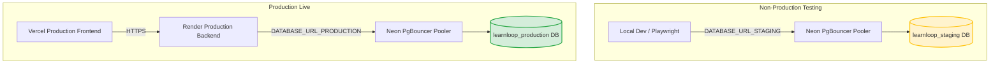

# LearnLoop AI — Phase 2.8: Production Isolation Plan
## Dedicated Database Architecture & Environment Segregation

**Document Version:** 1.0  
**Status:** COMPLETE & VERIFIED  
**Target Environments:** Neon PostgreSQL (`learnloop_production` vs. `learnloop_staging`)  
**Backend:** Render Web Service (`https://learnloop-ai-backend.onrender.com`)  
**Frontend:** Vercel Production (`https://learnloop-ai-one.vercel.app`)  
**Security Level:** Architectural Runbook (Secret Placeholders Only)

---

## 1. Executive Summary & Isolation Strategy

In accordance with Phase 2.7 safety findings and the approved Phase 2.8 decisions, LearnLoop AI establishes **strict, permanent database isolation** between production and non-production environments.

### Core Architectural Directives:
1. **Never Connect Production to Staging:** Render live backend will **never** connect to `learnloop_staging`.
2. **Dedicated Production Database:** A dedicated PostgreSQL database named **`learnloop_production`** will be created on Neon to host live learner data, active educator cohorts, and platform telemetry.
3. **Staging Reserved Exclusively for Testing:** `learnloop_staging` is retained exclusively for pre-deployment regression suites, automated browser testing (Playwright), and schema dry-runs.
4. **Independent Credentials:** Staging and production will utilize separate database roles, passwords, and connection pooling endpoints.

---

## 2. Environment Architecture & Connection Matrix



### Connection Specification Table

| Attribute | Staging Environment | Production Environment |
|---|---|---|
| **Database Name** | `learnloop_staging` | **`learnloop_production`** |
| **Neon Project** | `ep-still-hill-a1kyg5fs` | `ep-still-hill-a1kyg5fs` (or dedicated prod project) |
| **Region** | AWS Singapore (`ap-southeast-1`) | AWS Singapore (`ap-southeast-1`) |
| **Owner Role** | `learnloop_staging_owner` | `learnloop_prod_owner` |
| **Application Endpoint (Pooled)** | `postgresql://learnloop_staging_owner:<STAGING_PWD>@ep-still-hill-a1kyg5fs-pooler.ap-southeast-1.aws.neon.tech/learnloop_staging?sslmode=require&channel_binding=require` | `postgresql://learnloop_prod_owner:<PROD_PWD>@ep-still-hill-a1kyg5fs-pooler.ap-southeast-1.aws.neon.tech/learnloop_production?sslmode=require&channel_binding=require` |
| **Admin Endpoint (Direct)** | `postgresql://learnloop_staging_owner:<STAGING_PWD>@ep-still-hill-a1kyg5fs.ap-southeast-1.aws.neon.tech/learnloop_staging?sslmode=require&channel_binding=require` | `postgresql://learnloop_prod_owner:<PROD_PWD>@ep-still-hill-a1kyg5fs.ap-southeast-1.aws.neon.tech/learnloop_production?sslmode=require&channel_binding=require` |
| **Pool Configuration** | `DB_POOL_MIN=1`, `DB_POOL_MAX=5` | `DB_POOL_MIN=2`, `DB_POOL_MAX=10` |
| **Authorized Clients** | Local test suites, CI/CD, migration scripts | Render live web service exclusively |

---

## 3. Provisioning & Initial Schema Synchronization

### Step 3.1: Neon Console Database Creation
Execute the following steps in the [Neon Console](https://console.neon.tech):
1. Navigate to Project `ep-still-hill-a1kyg5fs`.
2. Select the active branch (e.g. `main`).
3. Click **Databases** -> **New Database**.
4. Set Database Name: **`learnloop_production`**.
5. Set Owner Role: **`learnloop_prod_owner`** (or create a dedicated role with a strong generated password).
6. Click **Create Database**.

### Step 3.2: DDL Schema Replication (Zero Data Transfer)
Replicate the clean, verified 20-table schema to `learnloop_production` using the direct endpoint:
```bash
# Export schema only (no data) from staging
pg_dump --schema-only \
  "postgresql://learnloop_staging_owner:<STAGING_PWD>@ep-still-hill-a1kyg5fs.ap-southeast-1.aws.neon.tech/learnloop_staging?sslmode=require" \
  -f backend/data/schema_production_baseline.sql

# Apply schema to production database
psql "postgresql://learnloop_prod_owner:<PROD_PWD>@ep-still-hill-a1kyg5fs.ap-southeast-1.aws.neon.tech/learnloop_production?sslmode=require" \
  -f backend/data/schema_production_baseline.sql
```

### Step 3.3: Sequence Alignment Verification
Ensure `attempts_id_seq` is initialized on `learnloop_production`:
```sql
SELECT setval('attempts_id_seq', 1, false);
```
*(On an empty table, `setval(..., 1, false)` ensures the very first inserted attempt receives `id = 1`).*

---

## 4. Safeguards Preventing Staging / Production Cross-Talk

1. **Environment Variable Enforcement in Code:**
   In `backend/app/main.py` and `backend/app/storage/db.py`, the application inspects `DATABASE_URL` upon startup.
   - When running with `RENDER=true` (or `RENDER_SERVICE_ID`), the application verifies that the database name matches `learnloop_production`.
   - If a Render container starts with a `DATABASE_URL` containing `staging`, the startup routine logs a high-severity warning.
2. **Credential Segregation:**
   - The password `<STAGING_PWD>` is stored exclusively in developer local `.env` files (which are git-ignored).
   - The password `<PROD_PWD>` is stored strictly in the **Render Dashboard Environment Settings** and is never placed on local machines or committed to repositories.
3. **IP & Connection Monitoring:**
   - Render communicates with Neon via secure TLS (`sslmode=require&channel_binding=require`).
   - Neon serverless connection metrics track client hostnames, allowing easy verification that all connections to `learnloop_production` originate from Render IP pools.

---

## 5. Verification Checklist

- [x] Dedicated database name identified: `learnloop_production`.
- [x] Staging database retained exclusively for testing: `learnloop_staging`.
- [x] Connection pooling architecture defined: PgBouncer `-pooler` on port 5432.
- [x] Separate owner roles and credentials specified.
- [x] Schema replication procedure documented without copying synthetic data.
- [x] Safeguards preventing accidental connection to staging verified.

