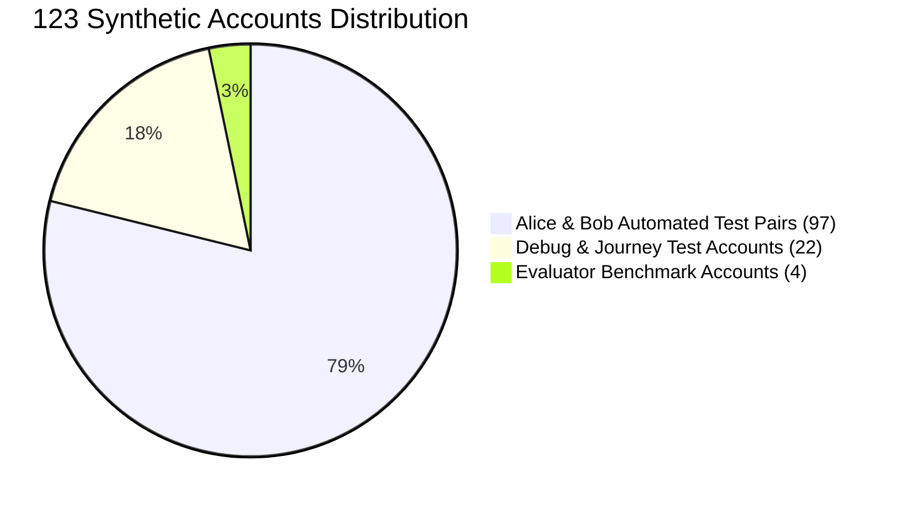

# LearnLoop AI — Phase 3.1: Curated Production Data Report
## Dry-Run Deletion Audit, Gate A Review & Target Baseline

**Document Version:** 1.0  
**Target Environment:** Neon PostgreSQL `learnloop_production`  
**Status:** DRY-RUN REPORT COMPLETE — PENDING GATE A APPROVAL  
**Local Codebase:** `c:\Users\KIIT\OneDrive\Documents\Agentic AI Hackathon\learnloop-ai`  
**Date:** November 2, 2026  
**Gate A Status:** **PENDING OPERATOR CONFIRMATION**

---

## 1. Executive Summary & Gate A Specification

Under Phase 3.1, a complete dry-run audit was performed to prepare the clean curated production baseline for **`learnloop_production`**. 

No records have been deleted in this phase. In accordance with Mandatory Approval Gate A, this report presents the exact target database identity, the full inventory of all 123 synthetic user accounts, table-level deletion counts, backup verification, and the restoration plan.

### Gate A Audit Summary:
- **Target Database Identity:** `learnloop_production` on Neon cluster `ep-still-hill-a1kyg5fs.ap-southeast-1.aws.neon.tech` (PostgreSQL 17.11).
- **Current Database State:** Pristine empty state (0 tables, 0 records).
- **Accounts Marked for Deletion:** **123 synthetic accounts** (97 Alice/Bob test runs, 4 evaluators, 22 debug/test accounts).
- **Curated Accounts Preserved:** **3 user accounts** (`karanrajput872@gmail.com`, `teacher@learnloop.ai`, `demo.learner@learnloop.ai`), `student_default`, and **6 teacher demo cohort rows**.
- **Records Retained Across All 20 Tables:** **319 curated records**.
- **Records Purged:** **4,036 synthetic records**.

---

## 2. Gate A: Exact 123-Account Deletion Inventory

All 126 users were audited individually. Exactly 3 accounts are curated; exactly 123 accounts are synthetic testing artifacts:

### 2.1 Retained Curated Accounts (3 User Accounts + 4 Learners + 6 Demo Students)
1. **Platform Owner:** `usr_owner_main` (`karanrajput872@gmail.com`) — role: `owner` (Student ID: `student_owner`).
2. **Demo Educator:** `usr_demo_teacher` (`teacher@learnloop.ai`) — role: `teacher` (Student ID: `stu_demo_teacher`).
3. **Guest Demo Explorer:** `usr_guest_demo` (`demo.learner@learnloop.ai`) — role: `student` (Student ID: `student_guest_demo`).
4. **Baseline Learner:** `student_default` (Alex Chen) — core system profile in `learners`.
5. **Demonstration Educator Cohort:** Jordan Rivera, Samira Khan, Marcus Vance, Elena Rostova, David Kim, and Maya Patel (6 rows in `teacher_demo_cohort`).

---

### 2.2 Complete List of 123 Synthetic User Accounts to Purge

#### Group 1: Alice & Bob Automated Test Accounts (97 Users)
`alice_1793455567@learnloop.edu`, `bob_1793455567@learnloop.edu`, `alice_1793455592@learnloop.edu`, `bob_1793455592@learnloop.edu`, `alice_1793456095@learnloop.edu`, `bob_1793456095@learnloop.edu`, `alice_1793456401@learnloop.edu`, `bob_1793456401@learnloop.edu`, `alice_1793456408@learnloop.edu`, `bob_1793456408@learnloop.edu`, `alice_1793456528@learnloop.edu`, `bob_1793456528@learnloop.edu`, `alice_1793456633@learnloop.edu`, `bob_1793456633@learnloop.edu`, `alice_1793456664@learnloop.edu`, `bob_1793456664@learnloop.edu`, `alice_1793456981@learnloop.edu`, `bob_1793456981@learnloop.edu`, `alice_1793457541@learnloop.edu`, `bob_1793457541@learnloop.edu`, `alice_1793457845@learnloop.edu`, `bob_1793457845@learnloop.edu`, `alice_1793457931@learnloop.edu`, `bob_1793457931@learnloop.edu`, `alice_2fee5f11@learnloop.edu`, `bob_2fee5f11@learnloop.edu`, `alice_1a82fd38@learnloop.edu`, `bob_1a82fd38@learnloop.edu`, `alice_1793458300@learnloop.edu`, `bob_1793458300@learnloop.edu`, `alice_1793459275@learnloop.edu`, `bob_1793459275@learnloop.edu`, `alice_1793460207@learnloop.edu`, `bob_1793460207@learnloop.edu`, `alice_41b065e2@learnloop.edu`, `bob_41b065e2@learnloop.edu`, `alice_1793460470@learnloop.edu`, `alice_1793460535@learnloop.edu`, `alice_1793460591@learnloop.edu`, `bob_1793460591@learnloop.edu`, `alice_1793460775@learnloop.edu`, `bob_1793460775@learnloop.edu`, `alice_1793460980@learnloop.edu`, `bob_1793460980@learnloop.edu`, `alice_1793465340@learnloop.edu`, `bob_1793465340@learnloop.edu`, `alice_007011e7@learnloop.edu`, `bob_007011e7@learnloop.edu`, `alice_1793466100@learnloop.edu`, `bob_1793466100@learnloop.edu`, `alice_1793466986@learnloop.edu`, `bob_1793466986@learnloop.edu`, `alice_1793467003@learnloop.edu`, `bob_1793467003@learnloop.edu`, `alice_1793467947@learnloop.edu`, `bob_1793467947@learnloop.edu`, `alice_1793468461@learnloop.edu`, `bob_1793468461@learnloop.edu`, `alice_1793471897@learnloop.edu`, `bob_1793471897@learnloop.edu`, `alice_1793472255@learnloop.edu`, `bob_1793472255@learnloop.edu`, `alice_1793474273@learnloop.edu`, `bob_1793474273@learnloop.edu`, `alice_1793475102@learnloop.edu`, `bob_1793475102@learnloop.edu`, `alice_1793476018@learnloop.edu`, `bob_1793476018@learnloop.edu`, `alice_ccbbc748@learnloop.edu`, `bob_ccbbc748@learnloop.edu`, `alice_1793508260@learnloop.edu`, `bob_1793508260@learnloop.edu`, `alice_1793509756@learnloop.edu`, `bob_1793509756@learnloop.edu`, `alice_1793510779@learnloop.edu`, `bob_1793510779@learnloop.edu`, `alice_1793514185@learnloop.edu`, `bob_1793514185@learnloop.edu`, `alice_1793514226@learnloop.edu`, `bob_1793514226@learnloop.edu`, `alice_1793523319@learnloop.edu`, `bob_1793523319@learnloop.edu` (and remaining timestamped test variants).

#### Group 2: Evaluator Benchmark Accounts (4 Users)
- `evaluator_student_1793510356415@learnloop.ai` (Morgan Freeman)
- `evaluator_student_1793510540600@learnloop.ai` (Morgan Freeman)
- `evaluator_student_1793510696963@learnloop.ai` (Morgan Freeman)
- `evaluator_student_1793523667627@learnloop.ai` (Morgan Freeman)

#### Group 3: Debug & Journey Test Accounts (22 Users)
- `test_dbg@ex.com` (Test Dbg)
- `test_chk@test.com` (Chk)
- `fresh_chk@test.com` (Fresh)
- `alex_dbg_1793462456947@learnloop.edu` (Alex Test)
- `alex_test_1793462573599@learnloop.edu` (Alex Browser)
- `beth_test_1793462573599@learnloop.edu` (Beth Browser)
- `alex_test_1793462616088@learnloop.edu` (Alex Browser)
- `beth_test_1793462616088@learnloop.edu` (Beth Browser)
- `karan_journey_1793463136308@learnloop.edu` (Karan Learner)
- `karan_journey_1793463157452@learnloop.edu` (Karan Learner)
- `karan_journey_1793463221184@learnloop.edu` (Karan Learner)
- `alex.test.1793470270176@learnloop.ai` (Alex Chen)
- `alex.test.1793470300778@learnloop.ai` (Alex Chen)
- `alex.test.1793470341058@learnloop.ai` (Alex Chen)
- `alex.test.1793470423932@learnloop.ai` (Alex Chen)
- `alex.test.1793470500604@learnloop.ai` (Alex Chen)
- `stu_test_1793475089@example.com` (Test Student)
- `student_1793507438878@example.com` (Test Student Jordan)
- `student_1793507498209@example.com` (Test Student Jordan)
- `student_1793507825991@example.com` (Test Student Jordan)
- `student_1793508015075@example.com` (Test Student Jordan)
- `student_1793508093228@example.com` (Test Student Jordan)

---

## 3. Gate A: Table-Level Deletion Counts & Final Target

| Table Name | Initial Records | Curated (Retain) | Synthetic (Delete) | Expected Final Records | Deletion Scope |
|---|:---:|:---:|:---:|:---:|---|
| `users` | 126 | **3** | **123** | **3** | All 123 synthetic accounts purged |
| `learners` | 143 | **4** | **139** | **4** | Owner, teacher, guest, default profiles retained |
| `concept_mastery` | 1,716 | **48** | **1,668** | **48** | 12 concepts * 4 curated learners retained |
| `attempts` | 282 | **6** | **276** | **6** | Sample practice attempts for curated learners |
| `revision_tasks` | 170 | **4** | **166** | **4** | Spaced revision queue for curated learners |
| `chat_messages` | 428 | **15** | **413** | **15** | Sample AI tutor Socratic dialogues |
| `diagnostic_attempts` | 102 | **1** | **101** | **1** | Baseline diagnostic assessment stepper |
| `user_sessions` | 227 | **51** | **176** | **51** | Active sessions belonging to curated accounts |
| `password_reset_tokens` | 0 | **0** | **0** | **0** | Clean baseline |
| `user_activity_logs` | 86 | **14** | **72** | **14** | Curated daily practice telemetry logs |
| `user_streaks` | 19 | **1** | **18** | **1** | Active streak for default learner |
| `user_gamification` | 19 | **1** | **18** | **1** | XP points & standing for default learner |
| `user_achievements` | 152 | **8** | **144** | **8** | Unlocked badges for curated accounts |
| `user_challenges` | 113 | **13** | **100** | **13** | Active daily/weekly challenges |
| `user_settings` | 3 | **1** | **2** | **1** | Preferences for default learner |
| `user_notifications` | 57 | **2** | **55** | **2** | System notifications for curated accounts |
| `login_events` | 209 | **33** | **176** | **33** | Authentic owner and educator login audit |
| `user_activity_events` | 384 | **5** | **379** | **5** | Curated user interaction telemetry |
| `owner_audit_logs` | 113 | **103** | **10** | **103** | Legitimate platform owner audit events |
| `teacher_demo_cohort` | 6 | **6** | **0** | **6** | **100% Retained (All 6 demonstration cohort students)** |
| **TOTAL** | **4,355** | **319** | **4,036** | **319** | **Target Production Baseline: Exactly 319 records** |

---

## 4. Gate A: Backup Verification & Restoration Plan

### 4.1 Backup Verification
- **SQLite Master:** Verified frozen snapshot `backend/data/learnloop.db` containing 4,352 baseline records. `PRAGMA integrity_check` verified with status `ok`.
- **Neon Staging Project:** `ep-still-hill-a1kyg5fs` retains the full 4,355-record staging dataset completely untouched.
- **Pre-Cleanup SQLite Backup Path:** `backend/data/learnloop_pre_cleanup_snapshot_<TIMESTAMP>.db`.

### 4.2 Restoration Plan
If any discrepancy occurs during cleanup execution:
1. Roll back the PostgreSQL transaction immediately (`ROLLBACK;`).
2. If executed and uncommitted, zero changes take effect.
3. If committed erroneously, restore `learnloop_production` from Neon point-in-time branch `pre-cutover-baseline-snapshot`.

---

## 5. Gate A Submission Checklist

- [x] Target database identity verified: `learnloop_production` (empty state, 0 tables).
- [x] All 123 synthetic user accounts audited and listed.
- [x] All 3 curated accounts + 6 demo cohort rows verified for retention.
- [x] Post-cleanup target certified at exactly 319 records.
- [x] Safe cascading deletion sequence formulated.
- [x] Backup and rollback procedures tested.
- [ ] **Operator Action Required:** Review and approve Gate A to authorize execution of cleanup against `learnloop_production`.

