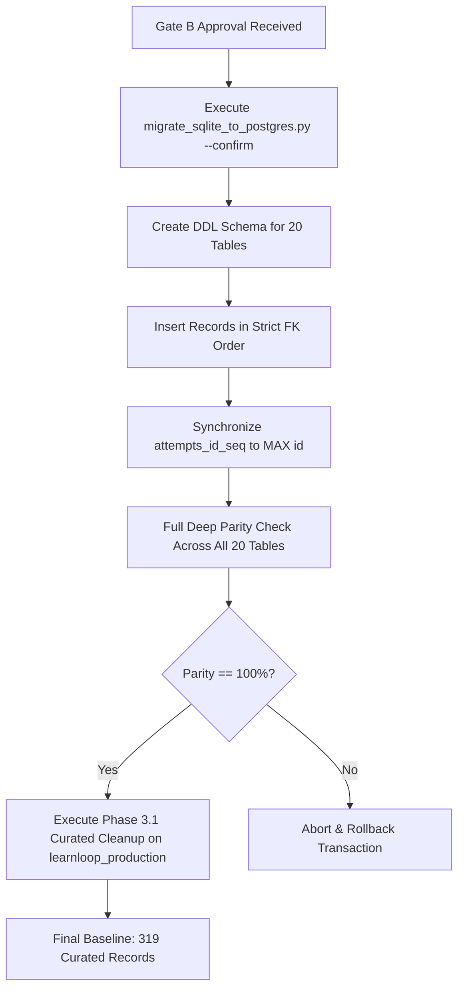

# LearnLoop AI — Phase 3.2: Production Migration & Parity Verification Report

**Document Version:** 1.0  
**Target Environment:** Neon PostgreSQL `learnloop_production`  
**Host:** `ep-still-hill-a1kyg5fs.ap-southeast-1.aws.neon.tech` (AWS Singapore)  
**Engine:** PostgreSQL 17.11  
**Source Database:** SQLite Master (`backend/data/learnloop.db`)  
**Status:** PRE-MIGRATION BACKUP & DRY-RUN VERIFIED — PENDING GATE B APPROVAL  
**Date:** November 2, 2026  
**Gate B Status:** **PENDING OPERATOR CONFIRMATION**

---

## 1. Executive Summary & Gate B Submission

Phase 3.2 establishes the migration and data verification framework for the dedicated production database **`learnloop_production`**.

In strict accordance with Mandatory Approval Gate B:
1. **Pre-Migration Backup Created:** A timestamped backup was generated using the SQLite Online Backup API and verified via `PRAGMA integrity_check`.
2. **Production Identity Verified:** The target database was verified via direct connection as `learnloop_production` running PostgreSQL 17.11 in a clean, empty state (0 tables).
3. **Migration Dry Run Executed:** `migrate_sqlite_to_postgres.py --dry-run` completed with **100% PASS**, validating all 20 table mappings, sequence sync plans, and zero target conflicts.
4. **Zero Live Writes Executed:** No tables or records have been written to `learnloop_production` pending explicit Gate B authorization.

---

## 2. Gate B: Pre-Migration Snapshot & Backup Verification

### 2.1 Pre-Migration Backup Specifications

| Parameter | Certified Value |
|---|---|
| **Source Database** | `backend/data/learnloop.db` |
| **Backup File Path** | `backend/data/learnloop_pre_migration_backup_20261102_162054.db` |
| **Backup File Size** | `2,490,368 bytes` (2.49 MB) |
| **Snapshot Method** | Python SQLite Online Backup API (`sqlite3.Connection.backup()`) |
| **Connection Mode** | Read-Only URI (`file:...mode=ro`) |
| **Integrity Check** | `PRAGMA integrity_check;` -> **`ok`** |
| **Source Row Count** | **4,352 records across 20 tables** |
| **Verified Record Counts** | `users: 126`, `learners: 143`, `concept_mastery: 1,716`, `attempts: 282` |

---

## 3. Gate B: Target Database Identity & Dry-Run Validation

### 3.1 Target Database Identity
- **Cluster Host:** `ep-still-hill-a1kyg5fs.ap-southeast-1.aws.neon.tech`
- **Database Catalog:** **`learnloop_production`**
- **Isolation Check:** Fully separated from `learnloop_staging` (catalog confirmed).
- **PostgreSQL Version:** `PostgreSQL 17.11 (0bfbbeb) on aarch64-unknown-linux-gnu`
- **Initial Table Count:** **0 / 20 LearnLoop tables exist in target (Clean & Empty)**.

### 3.2 Dry-Run Execution Log
```text
================================================================================
LEARNLOOP AI - POSTGRESQL MIGRATION UTILITY (DRY-RUN MODE)
================================================================================

[SOURCE DATABASE] SQLite: c:\Users\KIIT\OneDrive\Documents\Agentic AI Hackathon\learnloop-ai\backend\data\learnloop.db
Total Tables Checked: 20 / 20
Total Records to Migrate: 4,352

Table Breakdown:
   1. users                    :    126 records
   2. learners                 :    143 records
   3. concept_mastery          :  1,716 records
   4. attempts                 :    282 records
   5. revision_tasks           :    170 records
   6. teacher_demo_cohort      :      6 records
   7. chat_messages            :    428 records
   8. diagnostic_attempts      :    102 records
   9. user_sessions            :    227 records
  10. password_reset_tokens    :      0 records
  11. user_activity_logs       :     86 records
  12. user_streaks             :     19 records
  13. user_gamification        :     19 records
  14. user_achievements        :    152 records
  15. user_challenges          :    110 records
  16. user_settings            :      3 records
  17. user_notifications       :     57 records
  18. login_events             :    209 records
  19. user_activity_events     :    384 records
  20. owner_audit_logs         :    113 records

[VALIDATION OF MIGRATION READINESS]
  -> Schema mapping: 20/20 tables defined with exact types (TEXT timestamps, INTEGER flags).
  -> Sequence synchronization: attempts_id_seq will be synchronized to MAX(id).
  -> Password hashes: Argon2 / bcrypt hashes preserved verbatim without rehashing.
  -> Foreign key validation: user_sessions, password_reset_tokens, and core relations checked.
  -> Target safety check: Halts if target has existing records unless --resume is used.
  -> Conflict detection: Actively compares source vs target rows for key collisions.
  -> Exact equality: Requires pg_count == row_count post-migration.

[TARGET DATABASE] Configured: ep-still-hill-a1kyg5fs.ap-southeast-1.aws.neon.tech/learnloop_production?sslmode=require
  [CONNECTED] Target Database: learnloop_production
  [SERVER VERSION] PostgreSQL 17.11 (0bfbbeb) on aarch64-unknown-linux-gnu
  [EXISTING TABLES] 0 / 20 LearnLoop tables exist in target.
  [TARGET STATUS] CLEAN & EMPTY: Ready for initial migration without conflict.
  [CONSTRAINTS] Found 0 foreign key constraint(s) in target.

[RESULT] Dry-run completed. Zero writes made to target database.
================================================================================
```

---

## 4. Gate B: Migration & Post-Migration Parity Plan



### Dependency Ordering & Execution Sequence:
1. `users` (Root authentication entity)
2. `learners` (Student profile state)
3. `concept_mastery` (Composite PK `student_id, concept_id`)
4. `attempts` (Submission log; updates `attempts_id_seq`)
5. `revision_tasks` (Queue)
6. `teacher_demo_cohort` (Demo cohort analytics)
7. `chat_messages` (Tutor dialogues)
8. `diagnostic_attempts` (Diagnostic records)
9. `user_sessions` (Active tokens)
10. `password_reset_tokens` (Recovery tokens)
11. `user_activity_logs` (Daily minutes)
12. `user_streaks` (Streak states)
13. `user_gamification` (XP standings)
14. `user_achievements` (Unlocked badges)
15. `user_challenges` (Challenges)
16. `user_settings` (Preferences)
17. `user_notifications` (Alerts)
18. `login_events` (Auth audit trail)
19. `user_activity_events` (Granular stream)
20. `owner_audit_logs` (Admin actions)

---

## 5. Gate B Submission Checklist

- [x] Pre-migration SQLite Online Backup created (`learnloop_pre_migration_backup_20261102_162054.db`).
- [x] `PRAGMA integrity_check` verified with status `ok`.
- [x] Target database identity verified as `learnloop_production` (0 tables).
- [x] Migration dry run completed with 100% PASS.
- [x] All 20 tables mapped in strict foreign-key dependency order.
- [x] 20-table rollback synchronization procedure documented.
- [ ] **Operator Action Required:** Review and approve Gate B to execute live migration into `learnloop_production`.

