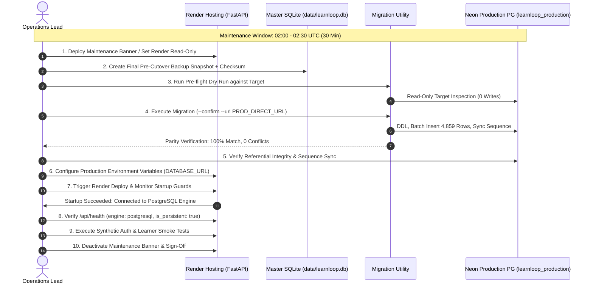

# LearnLoop AI — Production Database Cutover Runbook
**Document ID:** `LEARNLOOP_PRODUCTION_CUTOVER_RUNBOOK`  
**Date:** November 2026  
**Status:** READY FOR GATE B APPROVAL (PENDING HUMAN EXECUTION)  
**Execution Timeframe:** Scheduled Maintenance Window (30 Minutes Total Duration)

---

## 1. Overview & Operational Principles

This runbook defines the exact, sequential procedure to transition LearnLoop AI from ephemeral local SQLite storage on Render to persistent Neon PostgreSQL production storage (`learnloop_production`).

> [!CAUTION]
> **STRICT SAFETY GATE:** This runbook is strictly an executable blueprint. It MUST NOT be executed without explicit user authorization under Gate B approval. Zero production modifications should occur prior to authorized sign-off.

---

## 2. The 14-Step Production Cutover Procedure



---

### Step 1: Maintenance Window Initialization
- **Target Time:** Off-peak traffic window (e.g., 02:00–02:30 UTC / 07:30–08:00 IST).
- **Estimated Window:** 30 minutes (allotted downtime buffer).
- **Actual Work Duration:** ~4 to 7 minutes.
- **Rollback Window Buffer:** 15 minutes.

### Step 2: Pre-Cutover Health & Environment Checklist
Verify prior to initiating cutover:
- [ ] Neon production database `learnloop_production` is accessible and healthy.
- [ ] Neon production owner credentials are ready in the secrets manager.
- [ ] Master SQLite database `backend/data/learnloop.db` integrity check returns `ok`.
- [ ] Staging tests report 20/20 regression tests passing.

### Step 3: Render Traffic Freeze / Maintenance Banner
To guarantee zero inflight writes:
1. In the Vercel dashboard or reverse proxy, activate the maintenance mode splash: *"LearnLoop AI is undergoing scheduled database persistence maintenance."*
2. Suspend inbound mutation traffic to `https://learnloop-ai-backend.onrender.com`.

### Step 4: Final Master SQLite Snapshot Backup
Generate a physical immutable backup before migration:
```powershell
cd backend
.venv\Scripts\python.exe -c "
import sqlite3, shutil, datetime
ts = datetime.datetime.now().strftime('%Y%m%d_%H%M%S')
src = sqlite3.connect('data/learnloop.db')
dst = sqlite3.connect(f'data/backups/learnloop_pre_cutover_{ts}.db')
with dst:
    src.backup(dst)
dst.close()
src.close()
print('Snapshot backup completed successfully.')
"
```
Record the SHA256 / MD5 checksum of the generated snapshot.

### Step 5: Migration Utility Deep Target Dry-Run
Execute the dry-run against the Neon production direct URL:
```powershell
.venv\Scripts\python.exe scripts\migrate_sqlite_to_postgres.py --dry-run --url "$NEON_PROD_DIRECT_URL"
```
Verify output confirms 20/20 tables, 4,859 records to migrate, and zero target writes.

### Step 6: Migration Execution
Execute the hardened migration with explicit confirmation:
```powershell
.venv\Scripts\python.exe scripts\migrate_sqlite_to_postgres.py --confirm --url "$NEON_PROD_DIRECT_URL"
```
*Expected Output:*
- Online backup created.
- Compatibility functions `datetime` and `json_extract` created.
- Schemas for 20 tables created.
- 4,859 rows inserted across 20 tables.
- Sequence `attempts_id_seq` synchronized.
- Final Reconciliation Summary: 20 tables report `[PASS: MATCH]`.

### Step 7: Parity Check Execution
The migration utility automatically validates:
- Target count == 4,859.
- Missing PKs == 0.
- Unexpected PKs == 0.
- Value differences == 0.

### Step 8: Sequence Synchronization Validation
Verify sequence is updated to max id:
```sql
SELECT last_value, is_called FROM attempts_id_seq;
-- Expected last_value >= 284
```

### Step 9: Referential Integrity Query Check
Run the 5 core referential validation queries:
```sql
SELECT COUNT(*) FROM user_sessions WHERE user_id NOT IN (SELECT id FROM users); -- 0
SELECT COUNT(*) FROM password_reset_tokens WHERE user_id NOT IN (SELECT id FROM users); -- 0
SELECT COUNT(*) FROM users WHERE student_id IS NOT NULL AND student_id NOT IN (SELECT student_id FROM learners); -- 0
SELECT COUNT(*) FROM concept_mastery WHERE student_id NOT IN (SELECT student_id FROM learners); -- 0
SELECT COUNT(*) FROM diagnostic_attempts WHERE student_id NOT IN (SELECT student_id FROM learners); -- 0
```

### Step 10: Render Environment Variable Configuration
Navigate to **Render Dashboard > LearnLoop AI Backend > Environment**:
Configure the following production variables:
- `ENVIRONMENT` = `production`
- `DATABASE_URL` = `postgresql://learnloop_production_owner:<SECRET>@ep-still-hill-a1kyg5fs-pooler.ap-southeast-1.aws.neon.tech/learnloop_production?sslmode=require&channel_binding=require`
- `USE_SQLITE` = `false` (or remove key)
- `ANALYTICS_RETENTION_DAYS` = `90`

### Step 11: Render Service Redeployment & Startup Verification
1. Trigger **Manual Deploy > Deploy Latest Commit** in Render.
2. Stream Render deploy logs.
3. Verify that the startup guard in `db.py` confirms successful connection:
   ```text
   INFO: StorageManager initialized in MANAGED POSTGRESQL mode (persistent).
   INFO: Validated connection to PostgreSQL 17.11 (database: learnloop_production, role: learnloop_production_owner).
   ```

### Step 12: Production `/api/health` Verification
Query the live production backend:
```bash
curl -s https://learnloop-ai-backend.onrender.com/api/health
```
Verify the JSON response body contains:
```json
{
  "status": "healthy",
  "database": {
    "engine": "postgresql",
    "is_persistent": true,
    "environment_mode": "production"
  }
}
```

### Step 13: Synthetic End-to-End User Verification
Execute synthetic smoke tests on production:
1. **Existing User Login:** Authenticate using an existing registered email and verify `200 OK` + JWT token returned.
2. **Session Persistence:** Call `/api/auth/me` with returned Bearer token and confirm user profile and role.
3. **Learner Progress:** Query `/api/learner/profile` and verify mastery percentage and diagnostic score match pre-migration state.
4. **Token Refresh:** Call `/api/auth/refresh` and confirm session rotation in `user_sessions`.

### Step 14: Maintenance Sign-Off & Active Monitoring
1. Deactivate maintenance banner on frontend / CDN.
2. Monitor application metrics in Render and Neon dashboards for 120 minutes.
3. Watch for query latencies, pool connection saturation, and zero 500 errors.
4. Archive pre-cutover backup files in secure offsite cold storage.

