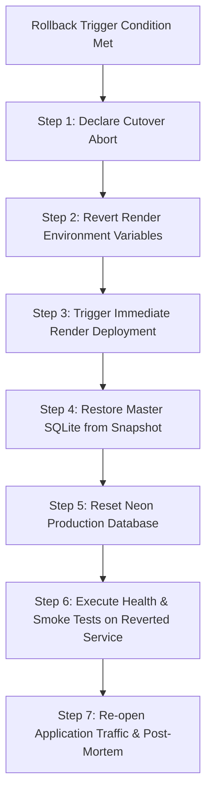

# LearnLoop AI — Rollback & Disaster Recovery Protocol
**Document ID:** `LEARNLOOP_ROLLBACK_AND_DISASTER_RECOVERY`  
**Date:** November 2026  
**Status:** VALIDATED & OPERATIONAL  
**Target Recovery Scope:** Production Cutover Reversion & Zero Data Loss Recovery

---

## 1. Objective & Recovery Targets

This protocol defines the disaster recovery procedures and automated rollback workflows for LearnLoop AI during or immediately following production database cutover.

- **Recovery Point Objective (RPO):** **0 minutes** (Zero data loss). Guaranteed by engine-enforced read-only access (`mode=ro`) on the source master SQLite database.
- **Recovery Time Objective (RTO):** **< 8 minutes**. Full application restoration to the previous stable state on Render.

---

## 2. Abort & Rollback Trigger Criteria

An immediate rollback must be initiated if any of the following conditions occur during the cutover window:

| Trigger Condition | Threshold / Failure Signal | Immediate Action |
| :--- | :--- | :--- |
| **Migration Script Error** | Any unhandled exception or failed transaction | Automatic transactional rollback in PostgreSQL. Abort cutover. |
| **Record Count Mismatch** | Final count != 4,859 rows across 20 tables | Halts before committing. Abort cutover. |
| **Parity Discrepancy** | `missing_pks > 0` or `differing_records > 0` | Abort cutover. Inspect divergence logs. |
| **Sequence Failure** | `attempts_id_seq` cannot be set to MAX(id) | Abort cutover. Prevent key collision. |
| **Render Startup Crash** | `RuntimeError` in startup guard or timeout (>3 min) | Roll back Render environment variables. |
| **Health Check Failure** | `/api/health` does not return `healthy` or 500 error | Roll back Render environment variables. |
| **Auth Smoke Failure** | Existing users unable to log in or token rejection | Roll back Render environment variables. |

---

## 3. Step-by-Step Rollback Execution Procedure



### Step 1: Declare Cutover Abort
- Notify engineering team that cutover is halted.
- Maintain maintenance splash page on frontend to protect users from inconsistent states.

### Step 2: Revert Render Environment Variables
In **Render Dashboard > Environment**:
1. Remove or unset `DATABASE_URL` (or restore the previous staging fallback if applicable).
2. Set `ENVIRONMENT` = `development` (or previous testing flag).
3. Save environment configuration.

### Step 3: Trigger Immediate Redeployment
1. Trigger **Deploy Latest Commit** in Render.
2. The service boots in standard fallback mode, verified by the startup guard.
3. Verify `/api/health` returns `200 OK`.

### Step 4: Verify Master SQLite Database State
Because the migration utility opened `backend/data/learnloop.db` with `mode=ro`, the physical database was never modified.
Verify the file checksum:
```powershell
Get-FileHash -Path "backend/data/learnloop.db" -Algorithm SHA256
```
Confirm the hash matches the pre-cutover snapshot in `backend/data/backups/`. If any deviation occurred, restore the backup snapshot:
```powershell
Copy-Item -Path "backend\data\backups\learnloop_pre_cutover_*.db" -Destination "backend\data\learnloop.db" -Force
```

### Step 5: Reset Neon Production Database to Pristine State
If the migration partially wrote tables before failing, reset the Neon production database back to 0 tables:
```sql
-- Connect via psql to Neon Production:
DROP SCHEMA public CASCADE;
CREATE SCHEMA public;
GRANT ALL ON SCHEMA public TO learnloop_production_owner;
GRANT ALL ON SCHEMA public TO public;
```
Verify that `SELECT count(*) FROM information_schema.tables WHERE table_schema = 'public';` returns `0`.

### Step 6: Post-Rollback Smoke Verification
1. Test `/api/health` endpoint on live Render deployment.
2. Test existing user login flow (`student_demo`, registered accounts).
3. Confirm learning path and concept mastery graphs load properly.

### Step 7: Reopen Traffic and Conduct Incident Review
1. Remove maintenance banner in Vercel.
2. Complete post-incident report detailing root cause of migration abort.

