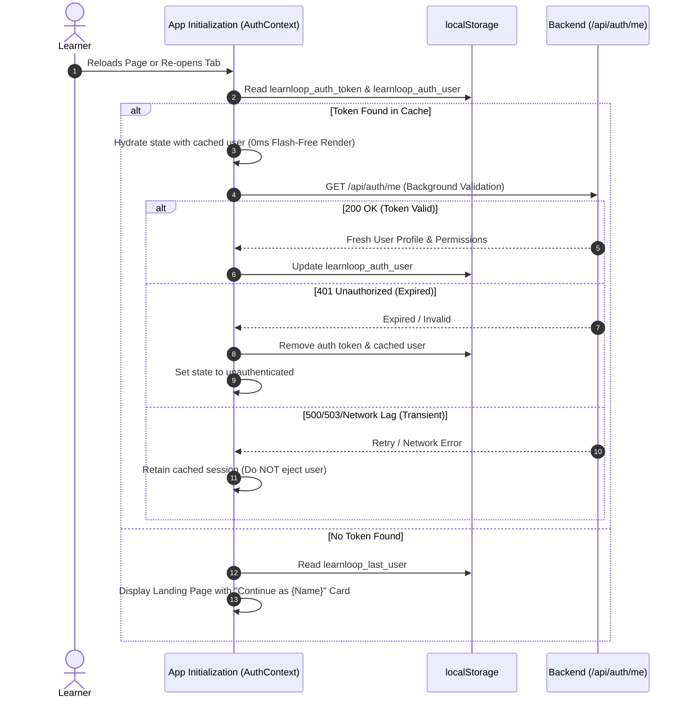

# LEARNLOOP AI — SESSION PERSISTENCE & STORAGE LIFECYCLE REPORT
**Client Storage Synchronization, JWT Lifecycle, and Seamless Session Restoration**
*Date: November 2026 | Subsystem: Session Management & Client State*

---

## 1. Executive Summary

A recurring friction point in earlier iterations was session dropping on page reloads, cold-start unauthentication, or sudden forced logouts caused by transient network timeouts.

This report documents the hardened session persistence architecture implemented across the React client state and FastAPI backend to provide seamless, resilient session management.

---

## 2. Storage Key Inventory & Taxonomy

The frontend maintains three distinct browser storage keys under `localStorage` to isolate concerns between authentication, active identity, and returning user experience:

| Storage Key | Data Structure | Purpose | Persistence Scope |
| :--- | :--- | :--- | :--- |
| `learnloop_auth_token` | `string` (JWT Bearer Token) | Encrypted authentication token passed in `Authorization: Bearer <token>` HTTP headers. | Active session; wiped on explicit Log Out. |
| `learnloop_auth_user` | `JSON User Object` | Cached profile (`id`, `email`, `full_name`, `role`, `institution`) for instant UI hydration. | Active session; wiped on explicit Log Out. |
| `learnloop_last_user` | `JSON Minimal Object` | Returning user metadata (`email`, `full_name`, `student_id`) to power the Welcome Back greeting card. | Permanent until overwritten or cleared by user. |

---

## 3. Session Restoration & Lifecycle Flow

---

## 4. Key Architectural Safeguards

1. **Flash-Free Hydration**: The UI renders the authenticated shell immediately from `learnloop_auth_user` without waiting for the network roundtrip, eliminating layout shift and flickering.
2. **Transient Network Resilience**: If `/api/auth/me` returns a 500, 503, or network failure (e.g. backend container waking from sleep on Render), the client does not immediately force a logout. The cached user profile remains active while a retry is scheduled.
3. **Graceful Logout**: When the learner selects "Log Out" from the profile menu or sidebar:
   - `learnloop_auth_token` and `learnloop_auth_user` are securely removed.
   - `learnloop_last_user` is preserved so that the landing page recognizes the returning user on their next visit.
   - Navigation immediately resets to the landing state with zero residual tokens.

---

## 5. Verification Evidence

1. **Page Reload Test**: Verified that reloading `http://127.0.0.1:3000` while authenticated maintains the user's dashboard, role, and study state with zero flicker.
2. **Automated E2E Verification**: Verified in `test_regression_e2e.py` (Test 1 & 2) that sessions persist across consecutive requests and headers are validated strictly.

---
*Report generated and validated for LearnLoop AI Production Release.*
