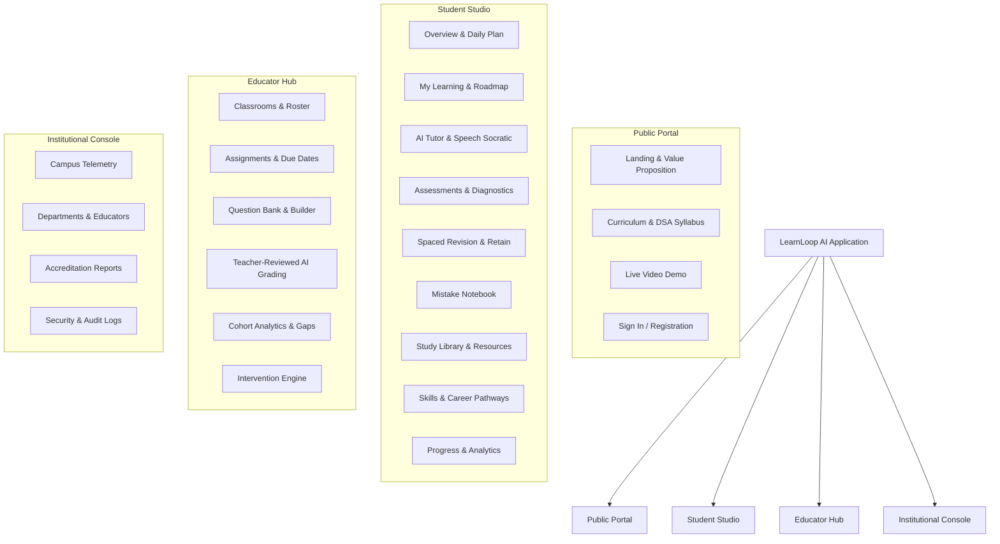
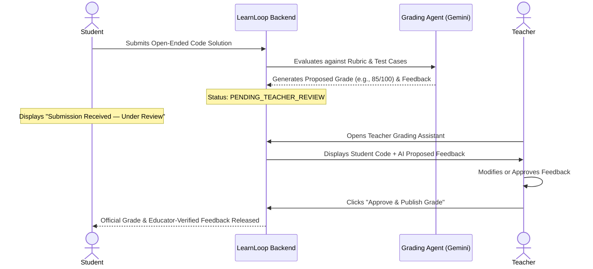

# LearnLoop AI — UX Redesign Plan
## Role-Specific Information Architecture, Student Experience & Educator Workflows

**Document Version:** 1.0  
**Target Roles:** Student, Teacher, Institution Administrator, Public Visitor  
**Security Architecture:** Strict Backend RBAC (`FastAPI` JWT Claims + Scope Authorization)  
**UX Standard:** Cohesive Academic Workflows, Zero Empty States, Accessible Layouts  
**Status:** **APPROVED SPECIFICATION — BLUEPRINT FOR PHASE IMPLEMENTATION**

---

## 1. Information Architecture & Navigation Strategy

The current navigation structure relies on a flat 7-tab list managed by React state (`activeTab`). To evolve LearnLoop into an internationally credible enterprise platform, the navigation is restructured into four dedicated, role-specific experiences.

Privileged views (Teacher, Admin, Owner) are **never gated by frontend visibility alone**. Every protected endpoint enforces server-side role validation in FastAPI (`verify_role("teacher")`, `verify_role("owner")`).



---

## 2. Role-Specific Navigation Architecture

### 2.1 Student Experience Navigation
```text
/student
├── /overview            -> Daily Learning Plan, Focus Timer, Streak & Goal Progress
├── /learning            -> Concept Mastery Graph, Prerequisites, Interactive Syllabus
├── /tutor               -> AI Socratic Dialogue, Wispr Flow Voice, Visual Code
├── /assessments         -> Diagnostic Stepper, Adaptive Practice Quizzes, Calibrated Tests
├── /revision            -> Modified SM-2 Spaced Repetition Queue, Due Flashcards
├── /mistakes            -> Mistake Notebook, Misconception Categorization, Retry Sandbox
├── /library             -> DSA Summaries, Algorithm Visualizers, Cheat Sheets, Interview Prep
├── /skills-career       -> Skill Pathways, Project Portfolio Evidence, Career Tracks
├── /progress            -> Mastery Radar, Activity Logs, Verified Achievements
└── /settings            -> Target Exam Selection, Audio/Voice Toggles, Theme (Dark/Light)
```

### 2.2 Teacher Experience Navigation
```text
/teacher
├── /overview            -> Real-Time Class Pulse, Immediate Interventions, Cohort Summary
├── /classrooms          -> Classroom Roster, Join Codes, Student Management
├── /assignments         -> Task Creation, Concept Targets, Due Dates, Submission Tracking
├── /question-bank       -> Syllabus Question Catalog, Custom Problem Authoring
├── /assessment-builder  -> Custom Quiz Builder, Diagnostic Exam Configurator
├── /grading-assistant   -> Teacher-Reviewed AI Grading (Pending Submissions Queue)
├── /lesson-planner      -> AI Pedagogical Unit Planner, Remediation Worksheet Generator
├── /analytics           -> Concept-Level Class Mastery, Misconception Heatmaps, Trends
├── /exports             -> PDF Progress Reports, CSV Gradebook Exports
└── /settings            -> Grade Scales, Co-Teacher Access, Notification Policies
```

### 2.3 Institution Administrator Navigation
```text
/admin
├── /overview            -> Campus-Wide Telemetry, Active Cohorts, Syllabus Completion
├── /departments         -> Academic Departments, Course Allocations
├── /educators           -> Faculty Accounts, Role Assignment, Class Load
├── /learners            -> Student Directory, Bulk Enrollment, Section Transfer
├── /reports             -> Institutional Performance, Accreditation Evidence, Equity Audits
└── /audit-security      -> Authentication Logs, Data Provenance, FERPA/GDPR Compliance
```

### 2.4 Public Website Structure
```text
/
├── /                    -> Hero, Interactive Concept Preview, Testimonials, Live Demo
├── /product             -> Adaptive Agent Architecture, Misconception Engine, Spaced Repetition
├── /for-students        -> Exam Preparation, Socratic Tutor, Socratic Voice Features
├── /for-teachers        -> Classroom Analytics, Gap Detection, Verified Grading Support
├── /for-institutions    -> Enterprise Scalability, LMS Integration (LTI 1.3), Privacy Guarantees
├── /pricing             -> Free Student Tier, Pro Exam-Prep, Institutional Campus Licensing
├── /about               -> Mission, Pedagogical Research, Deep Learning & Safety Principles
├── /signin              -> JWT Multi-Factor / Google Sign-In Flow
└── /get-started         -> Adaptive Diagnostic Onboarding Flow
```

---

## 3. Deep Dive: Enhanced Student Experience (Phase D)

### 3.1 Personal Learning Roadmap & Daily Learning Plan
- **The Problem Today:** The current dashboard displays high-level stats, but leaves the student unsure of what to do next.
- **The Redesign Solution:**
  1. **Daily Action Queue (Top of Dashboard):** Exactly 3 priority tasks dynamically generated based on cognitive status:
     - Task 1: *Due Spaced Revision* (e.g., 2 flashcards due today for `stacks`).
     - Task 2: *Adaptive Concept Focus* (e.g., Target `binary_trees` to resolve detected traversal misconception).
     - Task 3: *Daily Socratic Check-in* (e.g., 5-minute tutor chat on dynamic programming memoization).
  2. **Estimated Completion Time:** Visible indicator (e.g., *"Today's Plan: ~25 minutes"*).
  3. **Pomodoro / Focus Session Timer:** Embedded 25-minute focus clock directly in the study view with ambient distraction-free mode.

### 3.2 Mistake Notebook & Misconception Review
- **The Problem Today:** Failed attempts are saved in database `attempts`, but students cannot review or retry their missed questions.
- **The Redesign Solution:**
  1. **Auto-Categorized Error Log:** Missed quiz questions are automatically cataloged under the student's **Mistake Notebook**.
  2. **Misconception Tagging:** Questions are tagged with the specific underlying misconception identified by the AI agent (e.g., `LIFO_FIFO_CONFUSION`, `OFF_BY_ONE_INDEXING`, `RECURSION_BASE_CASE_OMISSION`).
  3. **Targeted Retry Mode:** *"Retry with Variation"*—The adaptive generator generates a isomorphic question with identical structural logic but different variables to test true conceptual repair.

### 3.3 Enhanced AI Tutor Experience
- **Speech Integration:** Retain Wispr Flow dictation with real-time speech cleaning (removing filler words and self-corrections).
- **Visual Socratic Cards:** Tutor output provides four interactive modalities:
  - *Socratic Question:* Guiding prompt rather than direct answer.
  - *Interactive Code Walkthrough:* Monospace syntax-highlighted snippet with line-by-line pointer.
  - *Concrete Analogy:* Real-world mental model (e.g., stack of cafeteria plates, queue at ticket counter).
  - *Counter-Example:* Concrete edge-case code demonstrating why the student's initial logic fails.

---

## 4. Deep Dive: Enhanced Teacher Experience (Phase E)

### 4.1 Classroom Creation & Roster Management
- **The Problem Today:** The current teacher page only shows synthetic cohort analytics; educators cannot create real classes.
- **The Redesign Solution:**
  1. **Classroom Entity:** Support multiple classes (e.g., *"CS 201 — Section A: Data Structures"*).
  2. **Join Code & Link Sharing:** 6-character alphanumeric join code (e.g., `DSA-702`) allowing students to self-enroll.
  3. **Student Directory & Roster:** View individual student mastery, last active date, completed diagnostics, and flagged learning struggles.

### 4.2 Teacher-Reviewed AI Grading Safeguard (Mandatory Safety Rule)
> [!IMPORTANT]
> **Strict Pedagogical Boundary:** AI-generated grades or qualitative feedback must NEVER be published as authoritative without explicit teacher review and approval.



### 4.3 Automated Learning-Gap Detection & Interventions
- **Cohort Misconception Alerts:** Highlights concepts where $>35\%$ of the class shares a misconception (e.g., *"Alert: 8 students in Section A confused BFS queue order with DFS recursion"*).
- **One-Click Remediation Assignment:** Generates a 5-question targeted practice set tailored specifically to clear the cohort's shared misconception.
- **Academic Export:** One-click CSV export formatted for standard LMS gradebook import (Canvas, Blackboard, Google Classroom).

---

## 5. Security & RBAC Enforcement Architecture

Frontend navigation items render according to user roles, but **access enforcement is guaranteed at the API boundary**:

```python
# Backend Enforcement Standard (FastAPI)
@router.post("/api/teacher/classrooms")
def create_classroom(
    payload: ClassroomCreateSchema,
    current_user: User = Depends(get_current_active_user)
):
    if current_user.role not in ("teacher", "owner", "admin"):
        raise HTTPException(
            status_code=status.HTTP_403_FORBIDDEN,
            detail="Access restricted: Teacher or Administrator privilege required."
        )
    # Execution logic...
```
