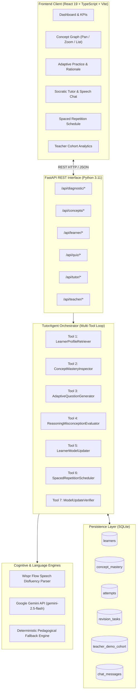
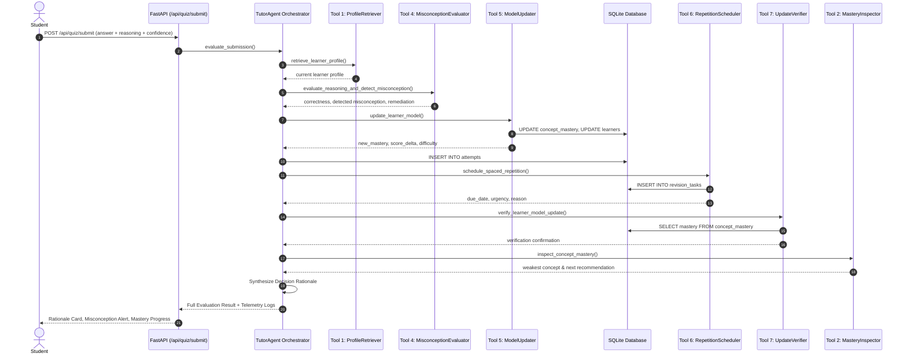
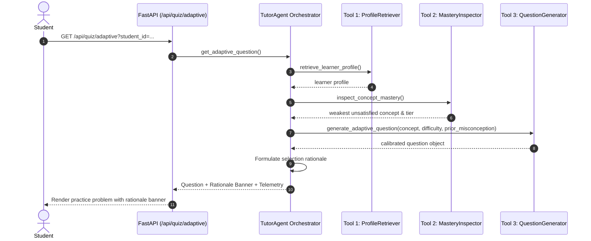
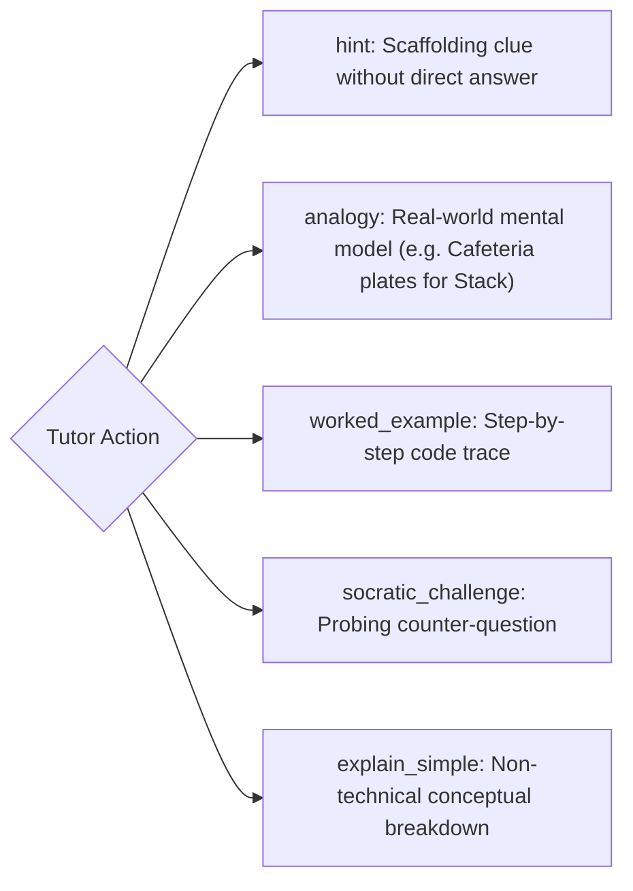
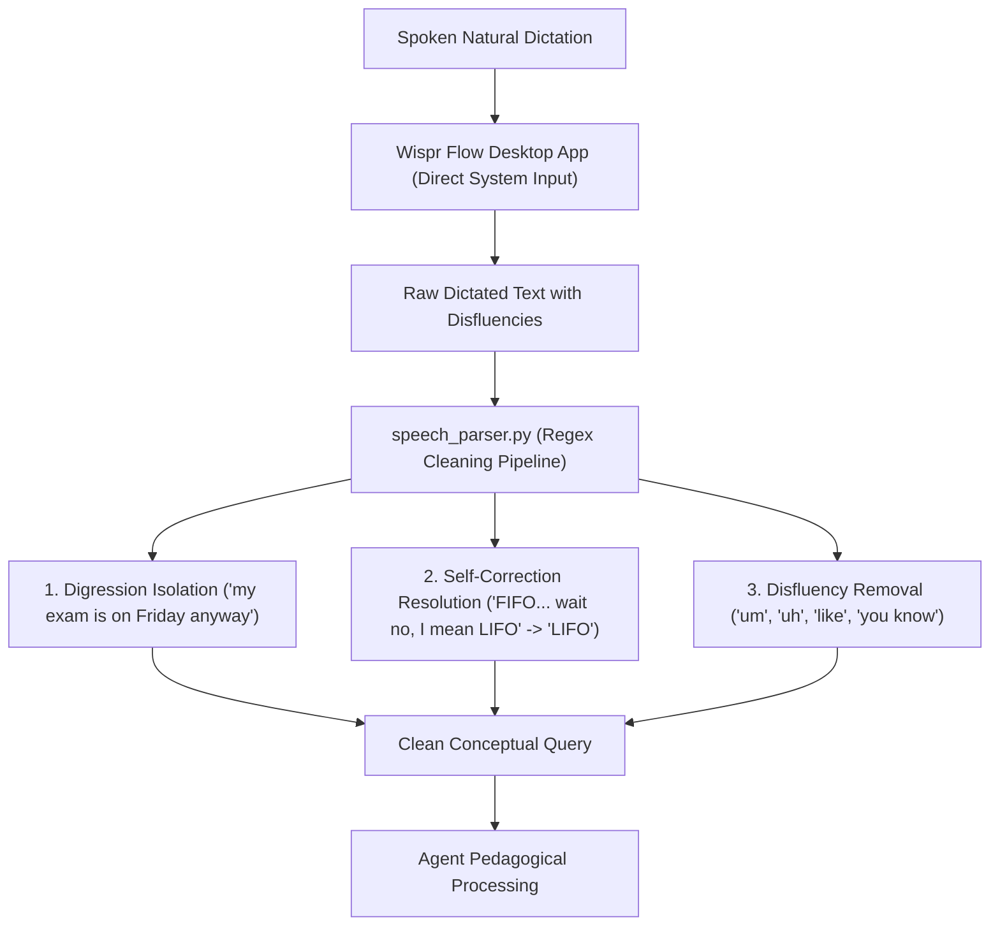
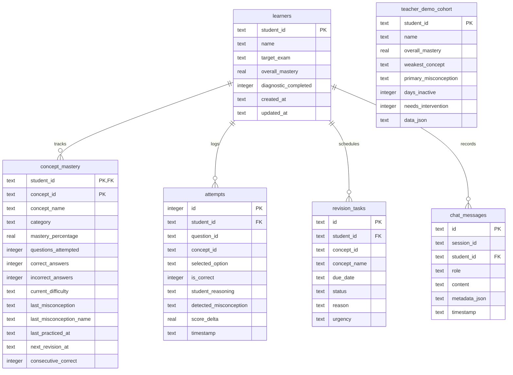

# LearnLoop AI — System Architecture & Agent Specifications

> **"Don't just learn the answers. Master the concepts."** 
> *Official Challenge: 02 — Adaptive Exam-Prep Tutor* 
> *Product Space × Wispr Flow Agentic AI Hackathon '26*

---

## 1. High-Level Architecture Overview

LearnLoop AI is an agentic, concept-first exam preparation platform designed for technical mastery in introductory Data Structures and Algorithms (DSA). Rather than functioning as a standard conversational chatbot or a multiple-choice grader, LearnLoop AI implements a **closed-loop pedagogical agent pipeline** that continuously inspects, updates, and verifies an evolving knowledge graph of student conceptual mastery.

---

## 2. Frontend-to-Backend Communication

Communication is structured around clean RESTful contracts defined via TypeScript types (`frontend/src/types/index.ts`) matching backend Pydantic schemas (`backend/app/models/schemas.py`).

| Domain | Route | Method | Payload / Parameters | Primary Responsibility |
|---|---|---|---|---|
| **System** | `/api/health` | `GET` | — | Returns health, model status, syllabus concepts, and active feature flags. |
| **Diagnostic** | `/api/diagnostic/questions` | `GET` | — | Delivers 12 diagnostic assessment questions covering all syllabus concepts. |
| **Diagnostic** | `/api/diagnostic/submit` | `POST` | `{ student_id, submissions: [...] }` | Evaluates initial assessment and initializes baseline mastery profile. |
| **Concepts** | `/api/concepts` | `GET` | `student_id` | Returns all 12 nodes, directed prerequisite edges, and live student mastery. |
| **Concepts** | `/api/concepts/{id}` | `GET` | `concept_id`, `student_id` | Returns deep conceptual details, prerequisites, and mastery history. |
| **Learner** | `/api/learner/profile` | `GET` | `student_id` | Fetches active profile, overall mastery score, and concept-wise states. |
| **Learner** | `/api/learner/history` | `GET` | `student_id` | Chronological log of student practice attempts and evaluation outcomes. |
| **Learner** | `/api/learner/misconceptions` | `GET` | `student_id` | Filtered log of diagnosed conceptual misconceptions. |
| **Learner** | `/api/learner/reset` | `POST` | `student_id` | Resets learner state to fresh unassessed baseline for demo purposes. |
| **Quiz** | `/api/quiz/adaptive` | `GET` | `student_id`, `concept_id?` | Generates a difficulty-calibrated question targeting the student's weakest concept. |
| **Quiz** | `/api/quiz/submit` | `POST` | `{ student_id, question_id, concept_id, selected_option, student_reasoning, confidence_level }` | Executes 6-tool evaluation pipeline; updates mastery; returns decision rationale. |
| **Tutor** | `/api/tutor/chat` | `POST` | `{ student_id, raw_transcript }` | Parses natural voice/text dictation, isolates disfluencies, returns Socratic response. |
| **Tutor** | `/api/tutor/action` | `POST` | `{ student_id, concept_id, action_type }` | Executes targeted pedagogical action (`hint`, `analogy`, `worked_example`, `socratic_challenge`, `explain_simple`). |
| **Tutor** | `/api/tutor/messages` | `GET` | `student_id`, `limit?` | Fetches persistent chat turns stored in SQLite. |
| **Tutor** | `/api/tutor/revision/tasks` | `GET` | `student_id` | Retrieves scheduled spaced-repetition tasks with urgency indicators. |
| **Tutor** | `/api/tutor/revision/complete` | `POST` | `{ task_id }` | Marks a scheduled revision task as completed. |
| **Teacher** | `/api/teacher/dashboard` | `GET` | — | Aggregates class-wide mastery, misconception frequency, and students requiring intervention. |

---

## 3. The Seven Specialized Agent Tools

The architecture organizes bounded capabilities into 7 isolated tools located in `backend/app/tools/`. Each tool logs structured execution telemetry (`tool_name`, `execution_time_ms`, `input_summary`, `output_summary`, `status`).

```mermaid
classDiagram
    class LearnerProfileRetriever {
        +retrieve_learner_profile(student_id)
        Loads learner profile and concept mastery records
    }
    class ConceptMasteryInspector {
        +inspect_concept_mastery(profile)
        Computes weakest concept and prerequisite readiness
    }
    class AdaptiveQuestionGenerator {
        +generate_adaptive_question(concept_id, difficulty, prior_misconception)
        Synthesizes calibrated question targeting specific gap
    }
    class ReasoningMisconceptionEvaluator {
        +evaluate_reasoning_and_detect_misconception(question_id, concept_id, selected_option, reasoning)
        Diagnoses LIFO/FIFO, BST ancestor, recursion flaws
    }
    class LearnerModelUpdater {
        +update_learner_model(student_id, concept_id, is_correct, misconception, confidence)
        Applies Bayesian mastery delta and difficulty tier transitions
    }
    class SpacedRepetitionScheduler {
        +schedule_spaced_repetition(student_id, concept_id, is_correct, mastery, confidence)
        Calculates SM-2 interval and dispatches revision task
    }
    class ModelUpdateVerifier {
        +verify_learner_model_update(student_id, concept_id, expected_mastery)
        Executes read-after-write verification to prevent corruption
    }
```

### Detailed Tool Specifications

1. **`LearnerProfileRetriever` (`app.tools.profile_retriever`)**
   - **Input:** `student_id: str`
   - **Responsibility:** Retrieves the current learner model from SQLite, including overall mastery, diagnostic completion status, and concept-by-concept mastery rows.
   - **Output:** Structured profile dictionary and telemetry log.

2. **`ConceptMasteryInspector` (`app.tools.mastery_inspector`)**
   - **Input:** `profile: Dict[str, Any]`
   - **Responsibility:** Traverses the topological syllabus graph, analyzes concept mastery percentiles, identifies the current weakest bottleneck concept whose prerequisites are satisfied, and determines readiness for difficulty elevation.
   - **Output:** Weakest concept ID, category, and prerequisite readiness flags.

3. **`AdaptiveQuestionGenerator` (`app.tools.question_generator`)**
   - **Input:** `concept_id: str`, `difficulty: str`, `prior_misconception: Optional[str]`
   - **Responsibility:** Selects or synthesizes a targeted question matching the student's active difficulty tier (`novice`, `intermediate`, `advanced`) and specifically targeting prior misconceptions if present.
   - **Output:** Formatted question object with 4 options and metadata.

4. **`ReasoningMisconceptionEvaluator` (`app.tools.misconception_evaluator`)**
   - **Input:** `question_id: str`, `concept_id: str`, `selected_option: str`, `student_reasoning: str`
   - **Responsibility:** Evaluates student reasoning text against the DSA misconception taxonomy. Identifies specific misconceptions (e.g. `stack_fifo_confusion`, `bst_ancestor_constraint_violation`, `recursion_missing_base_case`) and produces targeted remediation tips.
   - **Output:** Correctness boolean, detected misconception object, explanation, and pedagogical feedback.

5. **`LearnerModelUpdater` (`app.tools.model_updater`)**
   - **Input:** `student_id: str`, `concept_id: str`, `is_correct: bool`, `detected_misconception: Optional[Dict]`, `confidence_level: str`
   - **Responsibility:** Applies Bayesian knowledge-tracing updates to concept mastery. Computes score delta ($\Delta$), promotes/demotes difficulty tiers based on consecutive streaks, updates overall learner mastery, and logs timestamps.
   - **Output:** New concept mastery percentage, score delta, and new difficulty level.

6. **`SpacedRepetitionScheduler` (`app.tools.repetition_scheduler`)**
   - **Input:** `student_id: str`, `concept_id: str`, `is_correct: bool`, `mastery: float`, `confidence: str`, `detected_misconception: Optional[Dict]`
   - **Responsibility:** Calculates optimal review interval using a modified SuperMemo-2 (SM-2) algorithm. In urgent cases (such as high-confidence misconceptions), schedules review within 24 hours. Creates revision tasks in SQLite.
   - **Output:** Due date ISO timestamp, review interval in days, urgency tier (`urgent`, `medium`, `low`), and revision reason.

7. **`ModelUpdateVerifier` (`app.tools.update_verifier`)**
   - **Input:** `student_id: str`, `concept_id: str`, `expected_mastery: float`
   - **Responsibility:** Performs a read-after-write verification against the database to guarantee state integrity before returning the response to the client.
   - **Output:** Verification boolean and status log.

---

## 4. Execution Pipelines & Workflow Sequences

### 4.1 Answer Submission & Evaluation Workflow (6 Tools Sequentially)

### 4.2 Adaptive Question Generation Workflow (3 Tools)

---

## 5. Spaced Repetition Engine (Modified SM-2)

The spaced repetition algorithm calculates recall intervals based on three dynamic variables:
1. **Response Correctness** ($C \in \{0, 1\}$)
2. **Confidence Level** ($K \in \{\text{low: } 0.8, \text{medium: } 1.0, \text{high: } 1.2\}$)
3. **Misconception Severity** ($M \in \{0, 1\}$)

$$I_{\text{next}} = \begin{cases}
1.0 \text{ day (Urgent)}, & \text{if } C = 0 \text{ and } M = 1 \text{ and } K = 1.2 \text{ (High confidence mistake)} \\
2.0 \text{ days}, & \text{if } C = 0 \text{ (Standard mistake)} \\
\max(1, \text{round}(I_{\text{prior}} \times 2.2 \times K)), & \text{if } C = 1 \text{ (Reinforced success)}
\end{cases}$$

Revision tasks are automatically inserted into the `revision_tasks` table and surfaced on the student's Spaced Revision dashboard.

---

## 6. Socratic Tutor Actions Engine

Students can query the tutor using free-form dialogue or trigger one of five Socratic pedagogical quick actions:

When an action is submitted:
1. The student message is saved to `chat_messages` in SQLite.
2. The agent executes targeted action logic via Gemini API (if key is configured) or uses the rich deterministic fallback dictionary.
3. The assistant response is saved to `chat_messages`.
4. The client appends the turn and displays it in the Socratic chat timeline.

---

## 7. Wispr Flow Speech Parsing Architecture

LearnLoop AI provides an authentic desktop dictation workflow using **Wispr Flow**:

---

## 8. Database Schema (SQLite)

The persistence layer resides in `backend/data/learnloop.db` managed by `StorageManager` in `backend/app/storage/db.py`:

---

## 9. Fallback & Offline Resilience

LearnLoop AI provides **zero-credential functionality**:
- **Offline Mode**: If `GEMINI_API_KEY` is absent or network access fails, the platform automatically engages its `Deterministic Local Pedagogical Engine`.
- **Misconception Catalog**: Includes curated remediation advice for 15+ common DSA traps.
- **Socratic Content**: Complete deterministic fallback sets for all 12 concepts across all 5 quick-action types.
- **Self-Healing State**: If a student ID is accessed for the first time, `StorageManager.ensure_learner()` dynamically initializes the learner record and all 12 concept rows.
